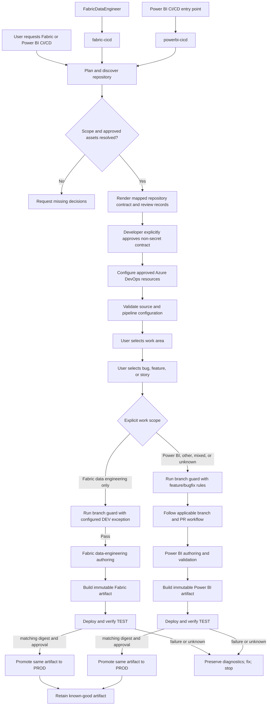
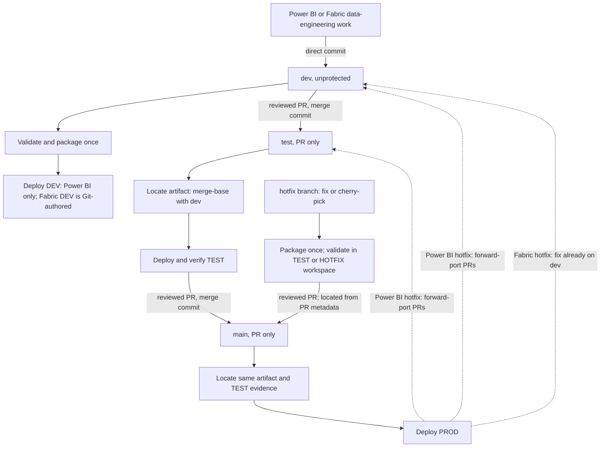

## Context

The existing `fabric-cicd` skill is intentionally a Fabric
data-engineering-only bootstrap. Its optional `pbi-assets.yml` validator
proves that Power BI mapping must be explicit, but it is not a Power BI
deployment implementation. The Glasslake `setup-fabric-cicd-environments`
change supplies the Power BI environment-bootstrap reference: an explicit
`pbi/` boundary, Git-disconnected deployment targets, idempotent `fab`
workspace setup, Azure DevOps PR governance, Key Vault-backed deployment
identity, sequential readiness gates, pilot isolation, and immutable
DEV/TEST/PROD promotion.

The new lifecycle must reuse those control-plane ideas without reusing
Glasslake resource names, identifiers, service-principal assumptions, or
Fabric data-engineering deployment behavior. See [proposal.md](proposal.md)
and the capability specification for the behavior contract.

## Goals / Non-Goals

**Goals:**

- Generalize the smallest connected Glasslake dependency set, preserve useful
  YAML compatibility, and present one Power BI setup flow with plan and
  recovery. Use PowerShell templates with `fab` and `az`, constrain all work
  to an explicit Power BI folder, and keep no project-specific identifiers or
  secrets as defaults.
- Give Power BI CI/CD first-class skill discovery and an independently
  testable setup/release contract.
- Preserve the common lifecycle shape: discover, map, plan, bootstrap,
  validate, build once, verify TEST, promote the same artifact, and retain
  rollback evidence.
- Reuse existing Power BI authoring, semantic-model, report-management,
  paginated-report, DAX-testing, and DevOps branch-routing capabilities at
  their established boundaries.

**Non-Goals:**

- Converting `fabric-cicd` into a mixed workload deployment tool, moving
  Fabric data-engineering content into the Power BI plugin, or changing the
  current branch-guard policy.
- Treating a mapping validator, repository folder, or discovered workspace as
  authorization to create resources or deploy.
- Supporting an item format merely by copying files or silently falling back
  to developer credentials, a different API, or an unsupported item type.
- Managing source data, refresh schedules, gateway configuration, capacity
  provisioning, or unrelated workspace content.

## Architecture Diagram

### Request routing and setup



### Branch and artifact flow: Power BI and Fabric together

Both lifecycles share these branches. Each pipeline triggers on the shared
branches but filters by its own source folder, so a merge only runs the
pipeline whose folder changed.



## Decisions

### 1. Add a sibling `powerbi-cicd` skill, not Power BI behavior to `fabric-cicd`

Create the Power BI lifecycle under `plugins/powerbi/skills/powerbi-cicd/`
with its own discovery metadata, source mapping, templates, commands, and
tests. It will cite the `fabric-cicd` documentation only for common lifecycle
concepts and update that skill's Power BI mapping note to point to the new
owner. The small existing `pbi-assets.yml` mapping contract becomes either a
migrated compatible input or a documented deprecation path, but is not left as
a Fabric-owned deployment mechanism.

This preserves the existing Fabric capability's explicit Power BI exclusion
and makes the skill trigger match the requested workload. Extending
`fabric-cicd` was rejected because it would combine unrelated item APIs,
permissions, source validation, and rollback contracts in one skill.

### 2. Use the Fabric-compatible PowerShell contract with Power BI extensions

`powerbi-cicd` will expose `Initialize-PowerBiCicd.ps1` with the same external
operator interface as `Initialize-FabricCicd.ps1`:

```powershell
Initialize-PowerBiCicd.ps1 -Mode Render|Plan|Apply|Status|Resume|Deploy `
  -ConfigPath <path> -ManifestPath <path> -RepoRoot <path> `
  -OutputRoot <path> -Target <UAT|TEST|PROD|REHEARSAL|HOTFIX> -ArtifactPath <path> `
  [-AllowOverwrite] [-AllowTargetWrite]
```

The configuration preserves the shared `repository`, `azure_devops`,
`dev_workspace`, `targets`, `roles`, `pipelines`, and
`protected_resources` sections. TEST and PROD are required profiles; UAT and
REHEARSAL are the only optional deployment profiles, and HOTFIX is a built-in
validation profile used only from `hotfix/*`. Each optional profile
must declare its workspace, pipeline, protected resources, artifact route,
and verification policy. The configuration changes `fabric_source_folder` to
`powerbi_source_folder`, and its manifest maps supported Power BI assets,
report/model dependencies, RDL bindings, and approved substitutions instead
of Fabric managed definitions. This is parameter-compatible at the setup
interface, not a claim that a Fabric manifest can deploy Power BI items.

The skill will first run read-only discovery. Its plan mode renders the
proposed source boundary and external actions with no writes; its apply mode
revalidates the approved contract before it creates or updates scoped Azure
DevOps resources. Developer-authenticated `fab` and `az` sessions provision
or verify the selected topology, direct role mappings, branch protections, and
named pipelines. Protected service identities are deployment-only.

Render also produces populated non-secret `CICD-SETUP.md` and
`CICD-VERIFICATION.md` records. They identify configured and resolved
workspace IDs, source and promotion branches, Azure DevOps pipeline and
environment references, service-connection and service-principal references,
direct role mappings, supported item scope, target-specific inputs,
prerequisites, verification, and recovery. They never contain credential
values. A developer records explicit approval of the reviewed contract revision
before apply can create or reconcile an external resource. The record and
approval schema is one shared contract under `common/`, also consumed by
`fin-2060-reference-fabric-bootstrap`, and is not implemented twice.

This mirrors the Fabric bootstrap's plan/apply discipline while avoiding an
assumption that `pbi/` or a workspace name is a deployable target. A broad
automatic scanner was rejected because it would make discovered source and
target state act as authorization.

### 3. Use the Glasslake gated environment topology as the bootstrap baseline

The reusable default is Git-disconnected DEV, TEST, and PROD workspaces that
receive only the packaged `pbi/` release artifact; optional UAT/REHEARSAL
targets follow the same boundary. `dev` is an unprotected integration branch
that accepts direct commits for any workload, so a shared repository can keep
Fabric data-engineering direct commits there; a validated push to `dev`
packages the artifact and deploys DEV. `test` and `main` are pull-request-only
(one reviewer, required validation; `test` completes by merge commit and `main`
also permits squash for hotfix pull requests): a reviewed
`dev`-to-`test` pull request deploys the recorded artifact to TEST, and a
reviewed `test`-to-`main` pull request deploys that same artifact to PROD. For
a small team, the first reviewed gate is therefore `dev`-to-`test`; branch
policy is the standard policy applied to `test` and `main` only. Production
hotfixes use a `hotfix/<Jira-key>` branch from `main`, an isolated HOTFIX
workspace with the PROD mapping, and forward-port pull requests to `test` and
`dev`. Each configured target has its own
workspace, generated and registered pipeline, target guard, environment
mapping, verification policy, and non-secret evidence. The bootstrap has five
gates: repository, workspace, identity-and-secret, governance, and pilot.
Every gate records non-secret evidence and prevents the next phase after a
failure. A configured adopter repository is the source of truth; copying a
source repository into a dedicated CI/CD repository is an explicit
configuration decision, not a hardcoded Glasslake behavior.

This takes the safety model from the Glasslake implementation without
embedding its workspace names, branches, Key Vault names, or capacity. Git
synchronization of any deployment target was rejected because it would bypass
artifact provenance, promotion evidence, and the pipeline's explicit target
contract.

### 4. Treat the Power BI adapter as a supported-item boundary

The release adapter will expose stable `validate`, `package`, `preflight`,
`deploy`, and `verify` operations for the item formats explicitly approved in
the contract. It will determine the tenant-supported Power BI/Fabric API or
client operation during read-only preflight and retain a tested supported-item
matrix. Semantic models deploy before reports and carry an explicit
per-environment source-connection binding map. Each map selects approved,
non-secret connection identifiers and requires direct deployment-identity
access; preflight rejects missing, unexpected, or personal-cloud bindings, and
post-deployment verification compares live model connections with the selected
mapping. RDL deployment requires an explicit data-source/model contract. Any
item without a safe approved path remains a blocking, classified result.

Substitutions and bindings use the adapter's native, per-environment keyed
rules (`find_replace`, `$items`/`$workspace` variables, and
`semantic_model_binding`), stored inside the hashed artifact and applied only
after artifact verification. Preflight checks that every rule has a value for
the target environment and matches a packaged file; deploy-time-resolved IDs go
into the evidence. The connection verifier is a port of the Glasslake
`validate_semantic_model_connections.py`, since the adapter binds but does not
verify live connections.

An existing semantic model may still be owned by the interactive account that
first published it. Before bindings are configured, the deploy wrapper checks
the target workspace for the model and performs an idempotent ownership
takeover to the deployment identity when it is not already the owner. New
models and models already owned by the deployment identity skip it. A failed
takeover stops the stage before binding and before any successful audit
record, so connection verification cannot pass against personal-cloud
bindings.

This follows the Glasslake design while avoiding generic REST wrappers and
file-copy "deployment." The exact implementation client is intentionally not
committed until its support and least-privilege behavior are verified against
the target tenant; this does not change the fail-closed external contract.

### 5. Separate offline PR validation from protected releases

Pull-request jobs run only local PBIP/PBIR/TMDL/RDL structure checks,
dependency analysis, configuration checks, committed-secret scanning, and
eligible source-only DAX checks. They do not load protected variable groups,
use the deployment identity, or connect to a workspace. Trusted stages resolve
the approved runtime identity only after preflight and never log secret
values. Environment mappings and named secret references remain reviewable;
credential values stay in Key Vault or the approved protected system.

Using one credentialed pipeline for all checks was rejected because it would
grant untrusted source changes access to deployment capability.

### 6. Build once and promote by verified digest

The post-merge pipeline packages the approved source subset, non-secret
configuration, dependency lock, manifest, revision, and content hashes once.
Each configured UAT, TEST, PROD, or REHEARSAL stage verifies that artifact
before writes. TEST validation produces the evidence and digest required for
protected PROD promotion; UAT or REHEARSAL is an independently configured
pre-production route and cannot substitute for TEST. Azure DevOps environments
carry target-specific guards and exclusive-lock controls, but no deployment
approval checks: the reviewed PR and successful validation are the manual
release gates for DEV, TEST, and PROD. The pipeline never rebuilds from a
different checkout for a deployment target.

TEST and PROD find the artifact by revision lineage, as the Glasslake
reference does: the source revision is the merge-base of the promoted commit
with `dev`, and the artifact is the one downloaded from the successful `dev`
build for that revision. A hotfix may be squash-merged, so it is resolved from
the completed pull-request metadata (merge commit to hotfix source commit for
`hotfix/*` sources), with the merge commit's second parent as fallback, and
the selected build must have a successful `ValidateHotfix` stage; it never
falls back to an unrelated `dev` artifact. `test` completes by merge commit.
Branch policy cannot be limited per source branch, so `main` also permits
squash; a squashed `test`-to-`main` pull request has no resolvable `dev`
merge-base build and blocks. Before any workspace write the stage requires the
selected revision to match the deployment branch's release files and the
artifact to contain every required deployment script; a missing build, failed
HOTFIX validation, missing script, or drift blocks. The
stored `source_digest` is the existing PROD gate against promoting a different
artifact; no additional digest recomputation or hash manifest is added for a
trusted team and platform-held artifacts.

This resolves the Glasslake concern that a production result could differ from
the reviewed revision. Per-environment rebuilds were rejected because they
weaken provenance and make rollback evidence ambiguous.

### 7. Consume existing specialist and DevOps boundaries

The new skill will hand PBIP/PBIR validation to the existing Power BI project
and report-authoring capabilities, semantic model changes and verification to
semantic-model authoring, RDL-specific work to paginated-report authoring, and
approved DAX execution to the existing test framework. It will invoke the
DevOps/Jira and `git-branch-guard` route before implementation work, passing
Power BI scope so the established normal feature/bugfix policy applies. It
will not duplicate branch policy, authoring implementation, or test
frameworks. The local branch guard is unchanged and keeps feature/bugfix
naming for Power BI work, while remote branch policy imposes no pull request
on `dev`.

The lifecycle acts as the coordinator of release evidence, not as a new
general Power BI authoring agent. Altering `FabricDataEngineer` to own Power
BI work was rejected because its present contract is expressly
data-engineering-focused.

### 8. Verify live state, preserve evidence, and recover by redeployment

After each deployment, verification compares the manifest with live managed
items, model/report bindings, configured substitutions, semantic-model source
connection bindings, model readiness, and applicable RDL bindings. The
immutable artifact carries the semantic-model connection verifier and selected
non-secret binding map. The audit record identifies source revision, hashes,
environment, workspace, identity reference, approval, timing, changed scope,
and result. Unexpected drift blocks promotion. Recovery selects a prior
known-good artifact and runs the same protected route; it does not converge or
delete arbitrary workspace items.

This makes partial failure observable and preserves unrelated content. Direct
manual rollback or destructive workspace synchronization was rejected because
it bypasses evidence and risks unmanaged items.

### 9. Adopt the tested reference scripts as generalized template assets

The Glasslake `cicd/powerbi/` scripts and stage YAML have run a live
DEV/TEST/PROD pilot, so they are the base for packaging, verification, and
deployment rather than a parallel implementation: `build_release.py`,
`deploy_artifact.py`, `deploy_fabric.py`, `validate_deployment_identity.py`,
`validate_semantic_model_connections.py`, `validate_parameters.py`,
`write_deployment_metadata.py`, `validate.yml`, `deploy-stage.yml`, and
`azure-pipelines.yml`, plus the PowerShell workspace and repository bootstrap
helpers. They become templates under `assets/templates/` with every
Glasslake-specific value (workspace names, `GLASSLAKE_*` variables, write
guards, model name, artifact name, `pbi/` root) read from the configuration and
manifest. The artifact layout follows the reference (content-hash manifest,
release metadata, managed manifest, deployment scripts included), and the
reference's promotion integrity checks are retained. `powerbi_cicd.py` keeps
discovery, configuration and manifest validation, and plan/render, which the
reference lacks. Rewriting the deploy layer independently was rejected because
it would discard live-verified behavior. Reference fixes are re-synced by
comparing against the source checkout recorded in the inventory.

## Risks / Trade-offs

- [Power BI API support varies by item type and tenant] → maintain a
  supported-item matrix; preflight the approved operation read-only; fail
  closed before writes for unsupported formats.
- [PBIR/TMDL and RDL dependencies can be indirect] → require explicit
  contracts when static analysis cannot resolve a binding and block ambiguity.
- [The same release concepts appear in two skills] → share lifecycle terms and
  cross-links, but keep workload-specific source, deployment, and rollback
  implementations separate.
- [Protected identity can be over-permissioned] → use explicit target mapping,
  per-environment least privilege, read-only preflight, and redacted evidence.
- [Cross-harness discovery may drift] → make source-owned skill metadata and
  targeted Codex, Copilot, and Claude discovery checks part of acceptance.
- [Unreviewed commits reach DEV] → run offline validation on every push to
  `dev` and require it on the `dev`-to-`test` pull request; DEV uses its own
  scoped identity, and the first review gate is accepted as `dev`-to-`test`.
- [Promotion by merge depends on ancestry] → require merge-commit completion on
  `test`; hotfix PRs resolve from PR metadata, and a squashed or rebased
  `test`-to-`main` PR blocks as a missing build.

## Migration Plan

1. Inventory the Glasslake bootstrap assets and current Power BI plugin
   capabilities; classify the smallest connected reusable dependency set.
2. Implement the Fabric-compatible PowerShell interface and non-secret base
   configuration, with a Power BI manifest and a compatibility transition for
   the existing optional mapping template.
3. Implement the sequential repository, workspace, identity, governance, and
   pilot gates; validate generated contracts and focused fixtures before any
   external write path is enabled.
4. Implement a supported, tenant-verified deployment adapter and protected
   Azure DevOps YAML for a synthetic non-production adopter; retain live
   target operations behind explicit operator selection.
5. Exercise the exact artifact through TEST verification, reviewed `test`-to-
   `main` promotion, drift blocking, and known-good rollback. Record unavailable live
   evidence as unverified.
6. Update Fabric, Power BI, DevOps, and multi-harness documentation; remove
   stale ownership language only after the new skill is validated.

Rollback of this capability is disabling its generated deployment pipeline and
restoring the previous skill/documentation revision. Rollback of a release is
redeployment of a retained known-good artifact through the same protected
route.

## Open Questions

- Does the supported `fabric-cicd` 1.3.0 adapter operate for each PBIP/PBIR/TMDL
  and RDL item family in a representative non-production tenant? The Glasslake
  dry run suggests so but did not authenticate; live support is unverified.
- Does `fabric-cicd` fail when a `find_value` matches no file or a rule lacks a
  target-environment value? The documentation only states that an invalid
  parameter file blocks deployment, so preflight must check coverage itself.
- Does the existing `pbi-assets.yml` contract have external adopters that
  require a compatibility period rather than an immediate relocation?
