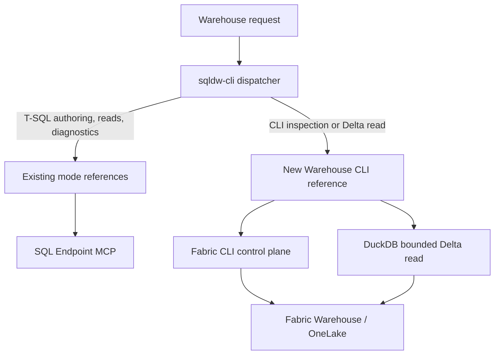

## Context

See [proposal.md](proposal.md) for the motivation. `sqldw-cli` is currently a
mode dispatcher: it routes T-SQL work to authoring, consumption, or operations
references and designates SQL Endpoint MCP as the preferred data-plane surface.
The upstream source provides a compact Warehouse-specific CLI reference that
covers lifecycle commands, Fabric resource inspection, and a DuckDB Delta-read
path. It does not include the destination skill's MCP and diagnostics model.

## Goals / Non-Goals

**Goals:**

- Add an attributed Warehouse CLI reference that is easy to discover from the
  dispatcher.
- Make resource discovery and DuckDB reads safe, bounded, and credential-safe.
- Keep clear separation between control-plane CLI commands, read-only Delta
  reads, and SQL Endpoint MCP execution.

**Non-Goals:**

- Replacing the existing authoring, consumption, or operations references.
- Adding Python automation, installing DuckDB, or changing Fabric resources.
- Reworking the broader `fabric-cli` skill or mirroring the complete source
  repository.

## Architecture Diagram

## Decisions

### Add a focused reference, not a fourth mode

The new material will be placed in a dedicated Warehouse CLI reference and
linked from the dispatcher as a complementary workflow. The three existing
modes classify SQL intent and must remain stable. A fourth mode would conflate
control-plane inspection and local read-only Delta tooling with T-SQL
execution.

Alternative considered: fold commands into `consumption.md`. Rejected because
the source also contains lifecycle operations and DuckDB is not the skill's
primary SQL execution surface.

### Preserve MCP-first T-SQL execution

The reference will state that `fabric-sqlendpoint-execute_query` remains the
default for T-SQL, with the CLI used for discovery and supported Warehouse
resource operations. This preserves the destination skill's endpoint behavior,
rate handling, and diagnostics guidance.

Alternative considered: promote DuckDB as a general querying path. Rejected:
it bypasses SQL endpoint semantics and is only appropriate for bounded,
read-only access to Delta files.

### Adapt source examples to repository safety rules

Examples will discover workspace and Warehouse identifiers at runtime, use the
Azure CLI credential chain, and bound queries with `LIMIT`. A deletion example
will be marked destructive and will require an explicit confirmation step
before execution. No client secrets, access tokens, or persistent credential
files will be added.

Alternative considered: retain commands verbatim. Rejected because the
repository's safety and authorization rules are part of its supported behavior.

### Preserve attribution in the imported reference

The reference will identify the upstream source repository and original
Fabric CLI author where applicable. The root README will only be changed if
the current acknowledgement does not already cover the exact imported source.

## Risks / Trade-offs

- [DuckDB Azure extension or CLI credential-chain support differs by local
  version] → Describe these as external prerequisites and provide clear failure
  guidance rather than implying automatic installation.
- [Users choose DuckDB for T-SQL-specific behavior] → State that DuckDB is a
  bounded Delta-read path and point T-SQL work to SQL Endpoint MCP.
- [Destructive CLI examples are copied without review] → Place the deletion
  command in a clearly labelled destructive section with a confirmation gate.
- [Upstream guidance becomes stale] → Attribute the source and keep the added
  reference narrow so it can be compared and refreshed independently.

## Migration Plan

1. Add the adapted Warehouse CLI reference and link it from `sqldw-cli`.
2. Run Markdown-link and documentation validation, then review the command
   examples for secrets, bounded reads, and destructive-action labelling.
3. Package normally; the change is additive and requires no migration for
   existing users.
4. Roll back by removing the dispatcher link and reference if validation or
   compatibility issues are found; existing mode references remain unchanged.
