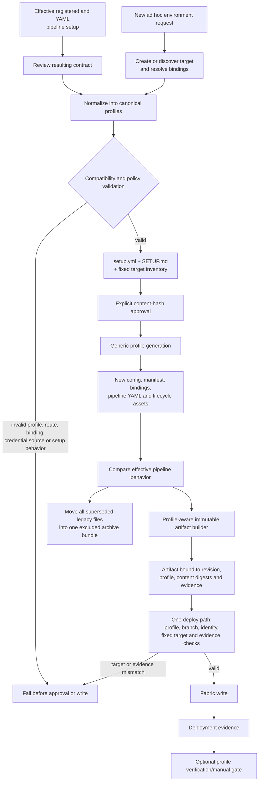

## Context

See proposal.md - Why. The current generator has a global `ENVIRONMENTS = ("DEV", "TEST", "PROD", "HOTFIX")` contract in plan, apply, binding generation, release helpers, validation and deploy runners. Pipeline rendering is keyed to fixed filenames and the PROD template contains separate TEST/HOTFIX selection logic. Generated `managed-items.yml` records workspace and dependency data but drops the DEV item `logicalId` discovered during planning.

The reference consumer's UAT environment was generated ad hoc. A bootstrap creates or discovers the target workspace, validates its schema-enabled Lakehouse and shells, records exact target identities, queues a UAT pipeline and retains a manual-verification boundary. The shared release builder is currently overwritten by the four-environment generator because its fixed UAT handoff is not part of the generated model.

This design keeps plan -> review -> approve -> apply, with an additional setup-time realization/import phase for ad hoc environments. It does not retain a runtime contract mode, introduce an environment state machine, or execute workloads during profile generation.

## Goals / Non-Goals

**Goals:**
- Make one approved environment-profile document drive setup, generated files, runtime validation, routing, evidence and rollback planning.
- Let an agent create/discover/import ad hoc targets and normalize them into the same profile schema used by persistent environments.
- Make TEST2, UAT and comparable profiles setup/configuration additions rather than generator source changes.
- Freeze ad hoc target identities and bindings before approval so the normal immutable release path deploys only to the approved fixed target.
- Preserve existing UAT manual verification as a profile-specific lifecycle requirement while migrating away from a permanent `--uat-contract` runtime interface.
- Keep PROD promotion explicit, immutable and fail-closed.
- Produce a deterministic migration of the legacy four-environment schema and preserve compatible custom assets.

**Non-Goals:**
- Dynamically redirect a packaged artifact to an arbitrary runtime workspace.
- Deploy Fabric workloads, modify customer data, schedules, triggers or item definitions during planning or apply.
- Read, write, reveal or migrate secret values.
- Infer promotion eligibility from profile names.
- Modify the Analytics Reporting repository.
- Add contract kinds or arbitrary runtime plugin schemas. Any custom setup is normalized to canonical profile data before the normal release path.

## Architecture Diagram



## Decisions

### 1. Environment profiles are the sole runtime registry

The setup schema becomes version 2 with `profiles` as a map keyed by stable profile key. The key may be DEV, TEST, TEST2, UAT, HOTFIX or PROD, but generators SHALL not branch on the name. A normalized profile contains:

```yaml
profiles:
  TEST2:
    name: TEST2
    lifecycle: persistent
    source_branch: TEST2
    workspace:
      name: Example [TEST2]
      id: <resolved-or-approved-id>
      capacity:
        name: <capacity>
        id: <capacity-id>
    azure_devops:
      pipeline_name: Example Fabric TEST2
      pipeline_yaml: cicd/fabric/fabric-test2.yml
      protected_environment: fabric-test2
      variable_group: powerbi eot
      private_pool: approved-private-pool
    credentials:
      key_vault:
        service_connection: Approved WIF connection
        name: protected-vault
        secret: fabric-deployment-client-secret
    bindings:
      replace_value_sets: all-managed-items
    deploy:
      enabled: true
    verification:
      required:
        - deployment-inventory
      manual_boundary: false
    promotion:
      role: verification-source
      accepts_from: []
      required_evidence:
        - artifact-validation-succeeded
        - deployment-succeeded
```

Keys are normalized with a strict identifier rule and duplicates fail after case normalization. Source routing uses an exact branch or a deliberately anchored pattern. Pipeline filenames, environment names and workspace identities are required to be unique where ownership conflicts would be unsafe. The profile set is persisted into generated configuration and passed to every helper, so adding TEST2 only changes `setup.yml` and reviewed generated output.

**Alternative considered:** keep `ENVIRONMENTS` but append names discovered from setup. Rejected because that leaves implicit behavior and stage-specific branches in numerous helpers, and does not solve generated templates or CLI `choices`.

### 2. Ad hoc realization is a setup operation, not a deployment mode

All profiles are fixed at runtime. `lifecycle` may describe a profile as persistent or ad hoc, but it does not alter the builder or deployer. Plan is read-only: it may only discover an existing target and read back its IDs and bindings. Creating an isolated workspace, capacity assignment, schema-enabled Lakehouse or managed shells is a distinct realization step that runs only after the developer approves a realization plan listing every resource to create. The resulting identities are converted into the canonical profile schema, rendered, and require a second explicit approval before generation or deployment.

The normal artifact metadata envelope contains profile key, lifecycle label, source branch, exact revision, resolved workspace and binding digest, source hashes and required evidence. `build_release.py` no longer uses a fixed argparse `choices` value; it accepts any approved profile key. It does not accept a runtime target contract or workspace override.

Existing `--uat-contract` usage is migration input only. An importer may read that contract, verify its source and target identities, and emit a canonical UAT profile. The generated end state uses `--target UAT` plus the profile's generated fixed mapping, and `--uat-contract` is rejected.

**Alternative considered:** retain contract mode for runtime UAT target selection. Rejected because it leaves UAT as a special deployment path and allows target identity to remain mutable after approval.

### 3. Templates render by profile data and policy, not stage name or lifecycle

Replace environment-named rendering loops with one profile pipeline renderer. The renderer emits build/validation and protected fixed-target deployment steps from the profile's resolved data. Promotion consumers additionally render artifact selection when `promotion.accepts_from` is non-empty. Optional lifecycle assets can add setup or verification steps, but they cannot change runtime target resolution.

The same renderer emits TEST2's or UAT's YAML at its configured path and uses its profile key only as data. PROD is not identified by special-case name; production behavior is enabled by explicit promotion role and `accepts_from`. For compatibility, legacy migration renders the familiar `fabric-dev.yml`, `fabric-test.yml`, `fabric-prod.yml` and `fabric-hotfix.yml` paths.

A new profile does not require a Python branch or template source edit. It requires a complete approved profile. The migration source of truth is the effective pipeline result: YAML path and branch, registered definition, parameters, protected resources, target workspace and bindings, artifact checks, and verification boundary. Old generator code is not imported into active generation. Once equivalent regenerated behavior is validated, superseded source, intermediate contracts and generated files move together under `archive/cicd/fabric/<migration-id>/`.

**Alternative considered:** generate one YAML file with a matrix. Rejected because Azure DevOps pipeline registration, protected resource authorization and existing pipeline ownership are cleaner and safer per profile.

### 4. Routing and promotion policy are explicit graph edges

Each profile records `promotion.role`, one of `development`, `verification-source`, `hotfix-source` or `production`; ad hoc is expressed by `lifecycle`, not role. Validation enforces the role: only `production` may have a non-empty `accepts_from`, and a `production` profile with `deploy.enabled: true` must have a non-empty `accepts_from`. A `production` profile with `deploy.enabled: false` is intentionally non-deploying. Only `promotion.accepts_from` grants a target permission to consume another profile's artifact. A profile can therefore be named TEST2 and be ineligible for PROD until PROD explicitly includes `TEST2`.

A PROD-like production profile with `accepts_from: [TEST, TEST2, HOTFIX]` resolves the merged pull request to exactly one source profile and one successful upstream build. Selection validation SHALL check:

1. source branch matches the source profile's declared route;
2. source profile appears in `accepts_from`;
3. evidence profile, artifact target, branch and revision are coherent;
4. every required upstream evidence item is successful;
5. artifact member hashes and the selected source content digest equal the candidate managed source;
6. the production target workspace equals the approved profile mapping;
7. no second source profile or build satisfies the merge ambiguously.

The legacy translator explicitly gives PROD `[TEST, HOTFIX]`; no new profile set receives this default. If a production profile has an enabled deployment but no `accepts_from`, validation fails rather than silently disabling promotion.

**Alternative considered:** infer eligibility from a suffix such as TEST or a role name. Rejected because names are not a security boundary and future stages would accidentally become production sources.

### 5. UAT is an imported ad hoc environment

Existing UAT behavior is migrated by reviewing its effective pipeline setup, not its bootstrap implementation. The importer validates the registered/YAML UAT pipeline, exact source branch/revision policy, target workspace and capacity, schema-enabled Lakehouse, managed-item inventory, generated bindings, deployment identities, protected resource authorization, artifact/evidence behavior and manual-verification boundary. It emits the same canonical UAT profile shape used for every other environment. The resulting profile owns fixed UAT workspace/Lakehouse/item bindings, so queue and release execution no longer supply target identity at runtime.

The normal builder produces an immutable `fabric-uat-release.zip`; the normal deployer resolves UAT from the approved profile and records deployment separately from manual verification. `deployment_succeeded` plus `manual_verification_pending/succeeded` prevents a successful definition deployment from implying UAT acceptance.

After the regenerated effective setup passes compatibility validation, `uat_bootstrap.py`, old target contracts and schemas, generator-specific tests, obsolete UAT pipeline/config overlays and other superseded UAT outputs are moved as one bundle to `archive/cicd/fabric/<migration-id>/`. That directory is outside all active scan, package, validation and generated-file sets. Git history provides rollback; duplicate legacy implementations do not remain alongside active artifacts.

The generated builder rejects `--uat-contract` with a hard error; no compatibility adapter exists. The importer keeps the existing UAT pipeline name and YAML path in the canonical profile by default, so the regenerated YAML and shared scripts replace the old ones in the same apply and commit and the registered pipeline needs no re-registration. Any change to the registered name, YAML path, protected environment or variable group is listed in the migration record as a manual external reconciliation step required before apply.

### 6. One versioned binding and manifest contract includes logical identity

Generated `parameter.yml` uses the same replacement expressions but obtains the set of replacement keys from the profile registry. The `replace_value` map SHALL contain every approved profile. For an ad hoc profile, realization completes all target-specific item resolution before approval, and the generated UAT binding values are fixed exactly like TEST2 or TEST values; no runtime overlay supplies target identities later.

`managed-items.yml` schema version 2 includes, for every item:

```yaml
- folder: BAM_SH_LH.Lakehouse
  type: Lakehouse
  name: BAM_SH_LH
  id: <DEV-item-id-when-available>
  logical_id: <Fabric-Git-logical-id-when-available>
  dependencies: []
```

`logical_id` is retained because Fabric Git-backed definitions and current consumer validation use both direct IDs and the logical/reversed GUID representation. The binding planner records both aliases. During migration, missing `logical_id` is backfilled through read-only DEV discovery; an unresolved required logical ID is a blocking gap, not inferred. A null value is permitted only when the item type or live discovery proves the identifier does not exist; the reason is recorded in the migration review.

A future replacement mechanism may be accepted only after tests prove equivalent direct ID, logical ID, SQL endpoint and Copy Job resolution, the new and old fields are emitted for at least one compatibility window, all known consumers pass, and migration approval marks the old field removable. Otherwise legacy logical-ID checks remain active.

### 7. Profile-aware scripts consume generated configuration, never secret values

Remove runtime environment allow-lists from `release_contract.py`, `build_release.py`, `deploy_runner.py`, `deploy_artifact.py`, `validate.py`, `validate_config.py`, `select_artifact.py`, binding generation and release recording. A shared profile loader validates the approved `config.yml`/manifest shape and returns only the selected profile.

All builders and validators remain secretless. Generated YAML stores the Key Vault service connection, vault name and secret reference, not a secret value. Protected jobs retrieve the client secret through the configured WIF `AzureKeyVault` task and export it only to the deployment process. If retrieval, identity or access fails, no variable-group secret, alternate environment variable, developer credential or interactive login is consulted.

A profile's standard variable group is validated for identity metadata and references, never for a usable client-secret value. Presence of a legacy secret variable is ignored for deployment and does not count as fallback readiness.

### 8. Regeneration inventories and reconciles existing assets

Before write generation, plan inventories the effective pipeline setup and active `cicd/fabric` files by content/hash and known schema marker. It classifies each active file as:

- `regenerated`: replaced by output derived from the approved profile set;
- `retained-active`: remains active because it implements independent verification or operations still required by the canonical setup;
- `shared-incompatible`: blocks with the effective behavior and remediation;
- `legacy-archive`: superseded together with the rest of the migration bundle.

The migration record lists the entire legacy bundle and its archive destination before any move. Apply computes the same inventory and refuses if the repository changed after approval. Archive directories are excluded from source scans, Python test discovery, artifact packaging, secret scanning for active generated output, and generated-file reconciliation except for a manifest/checksum proving what was moved. Existing active files are never left duplicated when their replacements are approved.

In particular, an existing `build_release.py` that supports `--uat-contract` is a legacy active output only. The new generated version must implement the approved canonical UAT profile before migration completes. Until effective UAT pipeline-equivalence tests pass, regeneration must fail. After they pass, the old builder, UAT bootstrap, old contracts/schemas, generator-specific tests and superseded outputs are moved into the same isolated archive bundle; they are not left active in parallel.

### 9. Backward compatibility is a deterministic v1 adapter

A v1 setup is normalized as follows:

| Legacy input | Profile role | Default promotion policy |
|---|---|---|
| DEV | development | none |
| TEST | verification-source | may emit verification evidence |
| HOTFIX | hotfix-source | may emit hotfix evidence |
| PROD | production | `accepts_from: [TEST, HOTFIX]` |

The adapter preserves legacy workspace IDs, branch values, pipeline names and YAML paths, variable-group references, Key Vault references, bindings and four generated pipelines. It writes v2 only after approval. Runtime readers keep v1 reading support for the migration window and emit a clear deprecation/migration error for writes against unsupported mixed versions.

UAT is detected or declared separately; no legacy translator invents UAT or changes an existing UAT pipeline. If a repository contains UAT assets without a UAT profile, compatibility validation blocks regeneration and asks that the profile be declared or the asset explicitly retired.

### 10. Test validation matrix

| Area | Legacy four profiles | TEST2 profile | Ad hoc/imported UAT profile | Required negative cases |
|---|---|---|---|---|
| Setup input | v1 translates identically | add profile data only | realize/import then emit canonical profile | missing/invalid fields, duplicate key, unresolved target |
| Routing | existing branches and YAML paths | TEST2 branch and pipeline only | approved UAT source route | unsupported branch, ambiguous route, cross-profile trigger |
| Workspace target | fixed DEV/TEST/PROD/HOTFIX | fixed TEST2 ID/name | fixed resolved workspace/Lakehouse IDs after setup | missing workspace, target mismatch, unapproved target change |
| Artifact | immutable per profile/revision | same generic builder | same generic builder with `--target UAT` | target not configured, digest/hash mismatch, runtime target override |
| Promotion | PROD accepts TEST/HOTFIX only from translation | accepted only if PROD explicitly lists TEST2 | not a PROD source unless explicitly configured | unsupported PROD source, missing/failed evidence, revision mismatch |
| Bindings | all legacy environment keys | TEST2 keys generated | realized UAT bindings generated before approval | unresolved binding, missing logical ID required by consumer |
| Secrets | approved Key Vault, no fallback | profile-specific approved Key Vault | approved Key Vault, no target input may supply credentials | missing service connection/access/secret reference, fallback rejection, secret scan |
| Evidence | existing deployment evidence | TEST2 deployment/validation evidence | deployment plus separate UAT manual verification | digest/evidence mismatch, manual verification falsely complete |
| Regeneration | unchanged effective behavior unless approved | adds active outputs without collisions | regenerates from canonical setup and archives the whole legacy bundle | incompatible pipeline result, mixed active/archived assets, stale approval |
| Compatibility | consumer with current generated files | no Python/template edit | logical-ID and migrated UAT profile tests | managed-item metadata regression |

All fixtures and tests are offline, deterministic and secretless. Each protected negative case asserts the operation fails before a Fabric write. A live repository compatibility run may be recorded as additional evidence but is not part of this planning change and is not a prerequisite for unit-test completion.

## Risks / Trade-offs

- [Generated v2 becomes too permissive] -> strict schema, normalized unique keys, closed credential/promotion fields and fixed resolved target requirements.
- [A profile name used in a PowerShell/YAML expression behaves unexpectedly] -> restrict keys and file slugs, quote generated values and add injection-oriented tests.
- [TEST2 or UAT requires hidden special cases in runtime scripts] -> tests must add both through fixtures only and prove the generic builder/deployer handles them from profile data.
- [UAT custom implementation is accidentally treated as active contract] -> derive compatibility only from effective pipeline setup, then archive the complete legacy implementation/output bundle after parity passes.
- [Logical IDs are absent or unstable in live discovery] -> backfill from `.platform`/DEV discovery where available, preserve direct ID and endpoint aliases, and fail unresolved required consumers rather than guess.
- [Explicit PROD eligibility blocks some existing non-TEST routes] -> v1 translation preserves TEST and HOTFIX only; all other sources require explicit migration policy and approval.
- [Ad hoc realization leaves a mutable target between discovery and approval] -> re-read target identity at generation/apply boundaries, bind the approved profile hash, and reject drift.
- [Stale `--uat-contract` invocation from an unmerged branch] -> generated builder fails closed with a clear error; the branch must pick up the regenerated commit.
- [Apply cannot safely revert an external authorization] -> generation rollback is file-level; external grants and pipeline registrations require a documented reconciliation/rollback step and are never hidden behind a destructive automatic rollback.

## Migration Plan

1. Add v2 profile schema, legacy parser/normalizer and deterministic compatibility report; do not change generated behavior until validation passes.
2. Snapshot the effective pipeline setup and active `cicd/fabric` files, classifying each as regenerated, retained-active, shared-incompatible or legacy-archive. Verify the approved inventory contains no secret values.
3. Translate v1 DEV/TEST/PROD/HOTFIX values one-for-one into canonical profiles. Preserve existing branches, pipeline names, YAML paths, workspaces, protected environments, variable-group references and Key Vault references. Explicitly translate PROD promotion sources to TEST and HOTFIX.
4. For repositories containing UAT or another ad hoc setup, review the effective registered/YAML pipeline setup, protected resources, source route, fixed target/bindings, artifact/evidence checks and manual-verification boundary. Map those results into a canonical profile. Do not treat generator source or filenames as the compatibility contract.
5. Run read-only plan and offline compatibility tests, including rendering `managed-items.yml` with `logical_id`, binding replay and comparison of effective pipeline behavior.
6. Produce the complete legacy archive manifest: old generator, intermediate contracts/schemas, generator-specific tests and superseded generated UAT outputs, with `archive/cicd/fabric/<migration-id>/` as the shared destination.
7. Obtain new approval for the normalized v2 setup, regenerated active outputs and archive manifest; the old setup hash is invalid for v2.
8. Apply generation, move the approved legacy bundle into the isolated archive directory, and then reconcile external pipeline/resource configuration idempotently. Active scanners, packagers and validators exclude the archive. No pipeline run, Fabric deployment or customer workload execution is part of migration apply.
9. Run the profile-aware offline matrix and, when separately authorized, validate consumer repository compatibility against its own tests. Record which checks are offline, installed-skill or live; never present planning evidence as runtime deployment evidence.
10. During the compatibility window, retain v1 readers and legacy pipeline paths. Exit criterion: every known adopter has an approved v2 setup or a recorded opt-out and the offline suite passes with v1 reading disabled; only then may a later approved change remove v1 writing and reading support.

## Compatibility Plan For Existing Generated Files And UAT Consumers

- Current DEV/TEST/PROD/HOTFIX adopters receive explicit equivalent profiles and retain the existing four pipeline filenames and target topology.
- Existing `config.yml`, `managed-items.yml`, `parameter.yml`, connection bindings and generated YAML gain schema/version metadata and profile maps; equivalent legacy readers are retained for the transition.
- `managed-items.yml` gains `logical_id` without removing direct ID/dependency fields. Missing IDs are not guessed. Repository tests that inspect logical IDs are included in compatibility validation.
- Existing profile CLI invocations that pass DEV, TEST, PROD or HOTFIX remain valid because those keys exist in the translated profile set.
- Existing UAT `--uat-contract` invocation is not supported after migration; the canonical end state uses the approved UAT profile with `--target UAT` and fixed generated target mappings, and the generated builder rejects the old flag.
- The effective UAT pipeline setup is the compatibility source. After canonical regeneration and parity validation, all obsolete UAT generators, intermediate contracts/schemas, generator-specific tests and superseded outputs are archived together under `archive/cicd/fabric/<migration-id>/`; active verification artifacts remain only when explicitly regenerated or required by the new profile setup.
- New TEST2 or UAT profiles require no Python or YAML-template source change after realization; they need only approved setup data and generated output review.

## Rollback Plan

- Before migration apply, preserve the prior generated files, `setup.yml`, approval hash and skill version/commit in the approved migration record.
- If generation or compatibility validation fails, apply performs no file replacement and no rollback is needed.
- If generated files were written or the legacy bundle was moved but no external profile action occurred, restore the prior reviewed active set and move the archive bundle back from `archive/cicd/fabric/<migration-id>/` as one versioned repository change; do not mix v1/v2 active artifacts or split the archive bundle.
- If pipeline/resource authorization was reconciled, restore or re-reconcile only the explicitly inventoried pipeline permissions, environment references and generated YAML. Do not delete live pipelines, workspaces, items, connections, variable groups or Key Vault resources automatically.
- If a new profile was added without production use, disable its pipeline trigger or registration through the normal approval workflow rather than deleting target data or workload state.
- A failed deployment rollback does not delete Fabric items or customer data. It restores the last known approved profile/generated configuration and requires a new reviewed deployment for any corrective write.
- The pre-change skill and committed consumer files remain installable until the consumer explicitly reruns and approves the profile migration.
