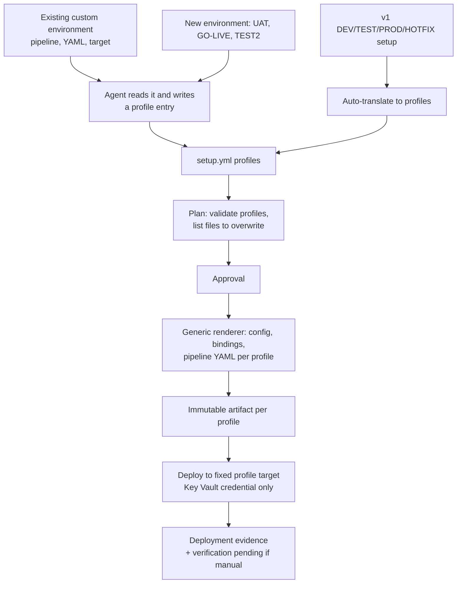

## Context

See proposal.md - Why. The generator has a global `ENVIRONMENTS = ("DEV", "TEST", "PROD", "HOTFIX")` contract in plan, apply, binding generation, release helpers, validation and deploy runners, and pipeline rendering is keyed to fixed filenames. Generated `managed-items.yml` also drops the DEV item `logicalId`. The flow stays plan -> review -> approve -> apply.

## Goals / Non-Goals

**Goals:**
- One approved profile list drives setup, generated files, runtime validation, routing and evidence.
- Adding UAT, GO-LIVE or TEST2 to an existing DEV/TEST/PROD setup is a config change.
- PROD promotion is explicit and fail-closed.
- Existing four-environment repositories keep identical behavior after translation.

**Non-Goals:**
- Tooling to create ad hoc workspaces (use `fabric-cli`), an importer program, an archive/move mechanism, or a `--uat-contract` adapter.
- Runtime target redirection, workload deployment, secret handling changes, or edits to the Analytics Reporting repository.

## Architecture Diagram



## Decisions

### 1. Profiles are the sole environment registry

`setup.yml` version 2 holds a `profiles` map. Keys match `^[A-Za-z][A-Za-z0-9_-]{0,31}$` (so `GO-LIVE` is valid), are case-insensitively unique, and are never branched on by name.

```yaml
profiles:
  UAT:
    source_branch: uat
    workspace: {name: Example [UAT], id: <id>, capacity: {name: <c>, id: <id>}}
    azure_devops:
      pipeline_name: Example Fabric UAT
      pipeline_yaml: cicd/fabric/fabric-uat.yml
      protected_environment: fabric-uat
      variable_group: powerbi eot
    credentials:
      key_vault: {service_connection: <wif>, name: <vault>, secret: <ref>}
    deploy: {enabled: true}
    verification: {manual_boundary: true}
    promotion: {accepts_from: []}
  PROD:
    ...
    promotion: {accepts_from: [TEST, HOTFIX]}
```

Validation rejects missing required fields, metacharacters in keys/values, and duplicate or conflicting keys, branch routes, pipeline paths, protected environments or workspace ownership. Only a profile with a non-empty `accepts_from` may consume another profile's artifact; a deploy-enabled PROD-like profile with an empty list fails validation. Ad hoc versus persistent is not a schema concept: a profile is a profile.

### 2. Generic rendering and runtime

One renderer emits per-profile pipeline YAML, `config.yml` workspace entries and binding replacement keys from the profile list. Runtime helpers (`release_contract`, `build_release`, `deploy_runner`, `deploy_artifact`, `validate*`, `select_artifact`, binding generation) read the approved generated config through a shared profile loader instead of an allow-list. `build_release.py --target <key>` accepts any configured profile. A runtime target contract or workspace override, including `--uat-contract`, is rejected with a clear error.

### 3. Explicit promotion and routing

Source branch routing matches exactly one profile; unknown or ambiguous routes fail. PROD-like selection resolves one source profile from `accepts_from` and checks source branch, exact revision, successful upstream deployment, artifact and member digests, and the fixed target workspace before any write. v1 translation gives PROD `accepts_from: [TEST, HOTFIX]`; new profile sets get no implicit sources.

### 4. Importing a custom environment is an agent task

The `SKILL.md` flow tells the agent, for an existing environment not in the template: read its pipeline definition, YAML, target workspace, protected environment and verification practice; fill the profile fields above; run plan; resolve anything the profile cannot express before approval. For a brand new target, create the workspace/Lakehouse with `fabric-cli`, then add the profile. The old bootstrap script is not an input contract. Plan shows every `cicd/fabric` file regeneration would overwrite and blocks on files it did not generate until acknowledged, so shared tooling is not silently replaced. Old UAT files can then be removed with a normal reviewed commit.

### 5. `logical_id` is preserved

Generated `managed-items.yml` adds normalized `logical_id` next to `id`, `name`, folder, type and dependencies. Missing values are backfilled from read-only DEV item and `.platform` discovery; an unresolved required value fails rather than being guessed. Binding generation accepts direct IDs, logical IDs, reversed IDs and SQL endpoint IDs.

### 6. Secrets and verification are unchanged

Protected jobs use the profile's Key Vault reference only; validation and build stay secretless; no variable-group or environment-variable fallback. When `verification.manual_boundary` is true, evidence reports deployment succeeded and verification pending until explicitly completed.

## Risks / Trade-offs

- [Schema breaks existing setups] -> deterministic v1 translation preserving branches, workspaces, pipelines, credentials and filenames, verified by an equivalence test.
- [Profile values reach YAML or PowerShell] -> strict key pattern and metacharacter rejection with tests.
- [Regeneration overwrites a custom environment's files] -> plan overwrite listing and block on unrecognized files.
- [Agent imports a custom environment incorrectly] -> the profile is reviewed in SETUP.md and approved before any write.
- [Stale `--uat-contract` call from an unmerged branch] -> generated builder fails closed with a clear error.

## Migration Plan

1. Add the profile model and v1 translator; confirm translated output is behavior-identical for DEV/TEST/PROD/HOTFIX.
2. Switch renderers and runtime helpers to profiles.
3. Regenerate an existing repository: plan lists overwrites; add UAT or GO-LIVE as a profile entry (agent-assisted when it already exists); approve; apply.
4. Keep v1 reading for a transition window. Exit criterion for removing it: all known adopters are on v2 and the suite passes with v1 reading disabled.

Rollback is a revert of the generated-files commit; external pipeline registrations and authorizations are not changed automatically.
