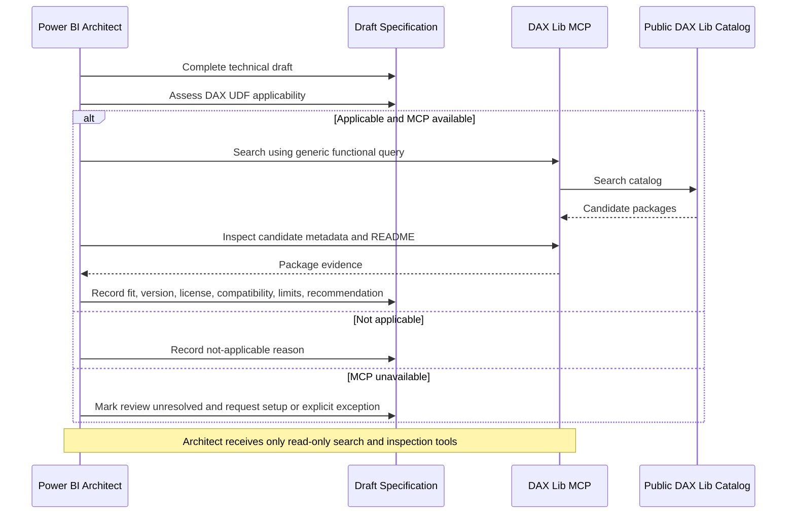

## Context

See [proposal.md](proposal.md) for the motivation and [the capability spec](specs/powerbi/dax-library-research-gate/spec.md) for observable behavior.

The Power BI plugin currently registers its modeling MCP in `plugins/powerbi/.mcp.json`; the architect's source instructions and checked-in Codex adapter are maintained separately and must stay aligned. DAX Lib MCP is a local server. Its documented launcher requires Node.js 18 or later; its published package currently supports Windows x64, and installing packages into a model additionally requires Power BI Desktop and model compatibility level 1702 or later. The architect only needs catalog search and package inspection, not package installation.

## Goals / Non-Goals

**Goals:**

- Make read-only DAX Lib discovery available to the Power BI architect in supported hosts.
- Place the review after the technical draft is complete and before final specification handoff.
- Keep catalog searches generic, record evidence and limitations, and preserve the architect's design-only role.
- Report unsupported host or unavailable MCP states clearly without making unrelated plugin setup fail.

**Non-Goals:**

- Install DAX packages or modify a live semantic model from the architect.
- Search general-purpose package registries or claim DAX Lib is a general code optimizer.
- Treat catalog presence as proof of correctness, compatibility, or performance improvement.
- Require Power BI Desktop for catalog-only research.

## Architecture Diagram

## Decisions

1. **Use the local DAX Lib MCP package.** Register the reviewed `@daxlib/mcp` release with the plugin's existing local-server pattern and a pinned package version. This follows the upstream-supported MCP integration and avoids floating `npx` installs. Update the pin only through a reviewed dependency change.

2. **Expose only read-only package research to the architect.** Allowlist package search, package metadata, and package README inspection. Do not expose `install_package` to the architect; it mutates a local Power BI Desktop model and conflicts with the agent's no-implementation boundary. If a host cannot enforce this tool allowlist, do not grant the architect a wildcard over the server.

3. **Keep source instructions and host projection aligned.** Add the MCP capability and gate behavior to `powerbi-architect.agent.md` and its Codex adapter, and validate parity. Register the server through the Power BI plugin's supported MCP configuration/projection path rather than adding machine-specific credentials or configuration.

4. **Run the gate at the final-draft checkpoint.** First complete requirements, architecture, acceptance criteria, and developer tasks. Then assess whether DAX UDF reuse is relevant. If relevant, search with a short generic description and inspect plausible candidates. If findings change the design, update the draft and repeat the review against the revised design before final handoff.

5. **Record evidence, not just a package name.** Add a dedicated `DAX Library Review` section to architect-authored specifications. Capture query intent, candidate package and version, source links, functional fit, compatibility evidence, license evidence or `unknown`, limitations, and recommendation. Distinguish DAX Lib's MIT-licensed MCP server from the individual community package licenses. A no-match and a not-applicable result are valid completed outcomes; an unavailable MCP is unresolved unless the user explicitly accepts an exception.

6. **Respect the public-catalog boundary and platform limits.** Search only with generic functional requirements; do not transmit client names, confidential model details, data, or credentials. Check runtime availability before invoking the local server. The published package's current support is Windows x64 and Node.js 18+; other platforms must receive a clear unavailable outcome. Desktop and compatibility level 1702+ apply to the separate install operation, not the read-only search gate.

### Alternatives considered

- **Expose every DAX Lib tool:** rejected because the server includes model-mutating installation, which is outside architect authority.
- **Add a generic library-discovery skill:** deferred because this request is specifically about DAX UDF reuse and the architect finalization checkpoint; a separate reusable skill would add another routing surface without changing the current user workflow.
- **Automatically install a recommended package:** rejected because package selection, compatibility testing, and model mutation require developer review and explicit user authorization.

## Risks / Trade-offs

- [The published server is currently Windows x64 only] -> Treat it as optional host capability; unsupported hosts report the gate as unavailable and do not fail unrelated plugin setup.
- [Community package metadata or licensing may be incomplete] -> Record unknowns explicitly and leave suitability/approval to the developer and user; do not infer an open-source license from the MCP server's MIT license.
- [A recommendation may be mistaken for a performance guarantee] -> Require model-specific validation before any performance claim.
- [Catalog queries could disclose sensitive design details] -> Limit queries to generic functional descriptions and prohibit sending data, credentials, or identifying model details.
- [Upstream tool names or behavior may change] -> Pin the reviewed server version and include a bounded MCP initialization/search smoke check in dependency updates.

## Migration Plan

1. Add the pinned server configuration and read-only tool exposure to supported plugin host projections; document Node.js and platform requirements.
2. Update architect instructions and the Codex adapter together, including the checkpoint and required review output section.
3. Validate configuration, tool allowlisting, instruction parity, and a catalog search on a supported Windows x64 environment. Verify unsupported-host and MCP-unavailable reporting without blocking unrelated setup.
4. Roll back by removing the DAX Lib server registration and architect tool exposure; retain the capability spec and allow the architect to mark the gate unresolved pending user-approved exception.

No semantic model migration is required because the architect does not install packages or alter models.