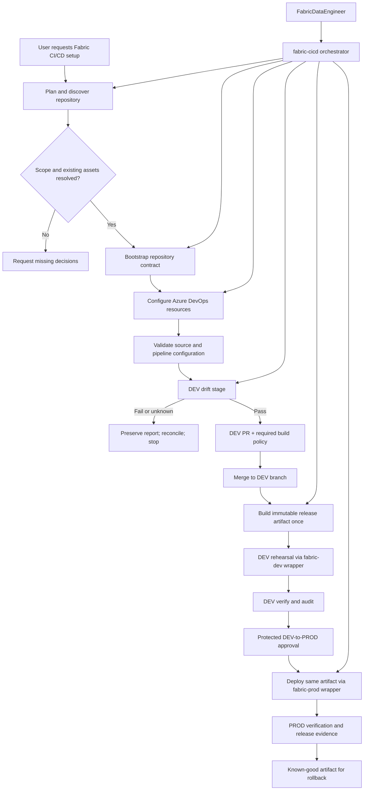

## Context

The existing Fabric plugin provides workload-specific skills and the DevOps plugin provides generic branch/Jira and PR behavior. The reference Analytics Reporting `cicd/` directory at commit `db118e88dff09f5c422a4351eeb024d8ba539cf0` contains working scripts, YAML pipelines, configuration and guidance for the desired operating model. Its `dev_drift_gate.py` is the comparator starting point; trusted server-side drift remains to be implemented. The local repository does not yet provide a reusable orchestrator that can establish this model for a new adopter.

See `proposal.md` and `specs/fabric/cicd-lifecycle/spec.md` for the motivation and behavior contract. The narrower `fabric-dev-definition-drift-gate` change remains a reference for the semantic comparator and is not the parent lifecycle.

## Goals / Non-Goals

**Goals:**

- Provide one orchestrator with safe, explicit modes for planning, bootstrap, configuration, validation, drift, release, status, and rollback guidance.
- Separate reusable lifecycle code from repository-local manifests, source layouts, workspace mappings, Fabric Git connection evidence, and identity references.
- Reuse the same validation/comparison contract locally and in trusted Azure Pipelines.
- Make repository and Azure DevOps setup idempotent, diffable, and recoverable.
- Preserve the boundary between interactive DEV source reconciliation, the explicitly authorized DEV rehearsal, and protected PROD deployment.

**Non-Goals:**

- Automatically deciding workspace IDs, service principals, branch-policy scope, or production approvals.
- Writing to DEV during pull-request validation. A post-merge DEV rehearsal is in scope only when its protected environment, identity, and target guard are explicitly configured.
- Moving data rows, schedules, credentials, or generated companion artifacts through Git.
- Replacing specialist Fabric workload skills or the generic branch/Jira guard.

## Decisions

### Architecture Diagram

### 1. Make `fabric-cicd` a staged orchestrator, not a single drift command

The skill will expose a stable command/mode contract while keeping each stage independently testable:

- **Plan/status:** read repository files and Azure DevOps/Fabric metadata; produce a plan or compliance report without writes.
- **Bootstrap:** render missing repository assets from versioned templates and show file diffs before replacing existing content.
- **Configure:** apply only approved Azure DevOps policies, environments, protected resources, and permissions; return resource IDs and status.
- **Validate:** run manifest, source, secret, dependency, and pipeline checks.
- **Drift:** export and compare live DEV definitions using the semantic comparator contract; the explicit local reconciliation operation synchronizes DEV definitions into repository source before revalidation.
- **Release:** create a revision-bound immutable artifact after validation.
- **Rollback guidance:** identify and, only after normal approval, redeploy a known-good artifact.

The orchestrator delegates workload-specific implementation to existing Fabric skills and delegates branch/Jira rules to `git-branch-guard`. This avoids creating a second general Fabric agent or embedding CI/CD policy in endpoint skills.

**Alternative rejected:** a single all-or-nothing setup command. It would make read-only discovery impossible, mix repository writes with external writes, and make partial recovery difficult.

### 2. Use a manifest as the repository adapter boundary

Each adopter supplies a `cicd/managed-items.yml` contract describing source root, DEV/PROD workspaces, item folders/types, logical IDs, dependencies, data policy, explicit exclusions, and a non-secret reference to the approved deployment identity. The repository adapter also records the Fabric Git connection, branch/path, initial synchronization direction/result, and source revision when workspace reconciliation is used. The orchestrator validates this contract before creating pipelines and passes it to the comparator, release builder, and deployment runner. Templates must not contain the reference project's workspace names, IDs, service-principal values, or item list.

The bootstrap stage may create a starter manifest only when the user supplies or confirms the workspace and managed-item mapping. It cannot infer a production identity from a display name or silently include all workspace items.

**Alternative rejected:** scanning the workspace and automatically managing every item. That creates an unsafe deployment scope and makes generated SQL endpoints, schedules, and data rows indistinguishable from deployable definitions.

### 3. Separate repository generation from Azure DevOps control-plane configuration

Repository setup renders CI/CD YAML, validation/release scripts, dependency locks, and documentation. Azure DevOps setup uses a separate adapter for path-scoped build-validation policies, environments, service connections, protected variable groups/Key Vault references, agent-pool authorization, and protected checks. The adapter first reads current state, displays a plan, and applies only a minimal idempotent diff after confirmation. Fabric and Power BI policies remain separately scoped, and Jira remains the default work-tracking integration rather than Azure Boards.

Secret values are never generated, copied into Git, or printed. The adapter accepts references to protected resources and verifies their existence/authorization without exposing values. If the user declines an external write, the repository plan remains usable and manual configuration steps are returned.

**Alternative rejected:** encoding Azure DevOps resource IDs or secret values in repository templates. That would couple the reusable skill to one tenant and create credential leakage risk.

### 4. Implement the reference pipeline topology as distinct trust zones

The generated lifecycle follows the README's separation of duties:

1. Secretless Git/source validation for ordinary PR checks.
2. Local/pre-PR reconciliation exports DEV definitions without writing Fabric, synchronizes managed source files from DEV when drift is detected, and revalidates before PR creation.
3. A trusted DEV drift build with protected read-only DEV identity, pinned Fabric CLI, and required Azure Repos branch policy. A local helper is an immediate pre-PR check, not the release-readiness control.
4. DEV merge starts a production-shaped rehearsal only through the protected `fabric-dev` environment; no DEV write occurs during the PR.
5. Immutable release packaging from the exact merged revision, consumed by both targets without checkout or rebuild.
6. DEV verification/audit followed by protected DEV-to-PROD promotion using an approved identity and environment approval.
7. Post-deployment verification, evidence recording, and rollback selection.

The reference adapter uses `fabric-release-stages.yml` for shared build/package/deploy/verify/audit behavior, with thin `fabric-dev.yml` and `fabric-prod.yml` wrappers. The lifecycle must generate equivalent contracts without copying project-specific paths or IDs. Each wrapper supplies its target workspace, environment, audit scope, and write guard (`ALLOW_FABRIC_DEV_WRITE` or `ALLOW_FABRIC_PROD_WRITE`). The release stages verify the immutable artifact and install pinned dependencies before invoking the deployment runner. DEV rehearsal is metadata/definition-only and should be safe to run repeatedly.

The same adapter/report contract is used by local and trusted drift stages. The secretless validation stage never obtains the protected Fabric identity merely to run source checks.

DEV is the authoritative source for this reconciliation. An explicitly invoked local sync stages and validates the complete managed export, converts supported export formats into canonical repository formats, and overwrites only the corresponding manifest-mapped source files. It preserves a recoverable copy of previous contents, including uncommitted edits, and produces a per-file report and Git diff for review. It does not commit, push, alter unrelated files or write to Fabric. Export, mapping, conversion, validation or partial-write failures block the PR and restore prior contents; a post-sync comparison must pass. The trusted PR job compares only and must never sync or push. If DEV changes after local sync, the trusted gate fails and the operator syncs and reviews again.

**Alternative rejected:** adding Fabric authentication to all PR validation or using PROD credentials for DEV export. Both violate least privilege and blur the source-validation/deployment boundary.

### 5. Treat release artifacts as the deployment source of truth

The release builder packages the merged revision, resolved manifest, dependency versions, source definitions, and content hashes. The deployment runner verifies those hashes and the approved target identity before writing. It does not checkout a newer revision or rebuild from a mutable workspace. DEV and PROD wrappers consume the same artifact. Partial deployment records affected items and stops dependent work so that rollback can use the last known-good artifact.

**Alternative rejected:** deploying directly from the Git working tree on the agent. That makes retries non-reproducible and prevents proving which source revision reached PROD.

### 6. Keep the drift comparator as a reusable child stage

Port the reference `cicd/dev_drift_gate.py` as the starting comparator, then extend and test it to meet this contract; do not assume that the reference already implements the full contract. The lifecycle consumes stable per-item `MATCH`, `DRIFT`, and `ERROR` results plus overall `PASS`, `DRIFT`, `ERROR`, and `UNKNOWN` result contract and report. Notebook handlers compare cell type/order/normalized source while ignoring serialization metadata; pipeline handlers parse JSON and ignore only approved export identity fields; `.platform` handlers allow only manifest-verified environment identity exceptions. Unsupported types, malformed or incomplete exports, missing canonical files, and ambiguous locations fail closed. Drift is mandatory for Fabric-scoped DEV PRs but does not own release packaging, policy setup, or deployment.

**Alternative rejected:** duplicating drift logic in each generated pipeline. Duplication would cause local and server-side validation to disagree and make normalization fixes unsafe to roll out.

### 7. Integrate with the existing Fabric orchestrator and DevOps helper

`FabricDataEngineer` routes cross-workload CI/CD requests to `fabric-cicd`. The generic branch/Jira guard continues to validate branch shape and ticket identity. The PR helper performs only manifest detection and stage delegation for DEV targets; it does not own Fabric parsers, workspace IDs, credentials, or deployment rules.

### 8. Co-locate source while separating workspaces and release scopes

The standard repository layout may contain both `fabric/` and `pbi/` source roots, but those roots map to separate DEV/PROD workspace pairs, manifests, protected identities, and release pipelines. Fabric assets use the Fabric managed-item contract; Power BI assets require a separate explicit mapping such as `pbi-assets.yml` before the lifecycle generates Power BI validation or release assets.

The lifecycle will model cross-domain dependencies explicitly: a Power BI release may depend on a successful Fabric release when the semantic model or report consumes Fabric-managed data, but the two pipelines remain independently approvable and independently scoped. A repository containing `pbi/` alone does not cause Fabric or Power BI deployment configuration to be inferred from folder presence.

**Alternative rejected:** one shared workspace or one combined credentialed pipeline. That would couple release permissions, make rollback ambiguous, and allow an unrelated Power BI change to mutate Fabric deployment state.

### 9. Keep runtime configuration protected and target-specific

Repository configuration may declare non-secret references to the approved service connections, protected variable groups, Key Vault-backed variables, pinned tool versions, agent queue, and target workspace IDs. A preflight must verify the protected resource can retrieve the required secret without logging its value before release readiness is granted. Secret values remain in protected Azure DevOps resources. The DEV and PROD wrappers use separate environments and write guards, while the shared stages accept only the resolved artifact and target contract. Verification and audit scripts must work for both targets and must fail closed when the target guard, protected identity, or required agent authorization is absent.

### 10. Ship the complete reference as a parameterized starter bundle

Inventory every tracked file at the reference commit and document its source, disposition, modifications, and tests. Package reusable code and templates with the skill; adopters do not need the reference checkout or network access to render the bundle. The initial disposition is:

| Reference files | Disposition |
| --- | --- |
| `auth_check.py`, `build_release.py`, `deploy_artifact.py`, `deploy_runner.py`, `dev_drift_gate.py`, `post_deploy_check.py`, `record_release.py`, `secret_scan.py`, `validate.py`, `validate_config.py`, `validate_powerbi.py`, `verify_deployment.py` | Port and generalize runtime and validation code; assess dependencies and close the gaps in this design before use. |
| `fabric-dev.yml`, `fabric-prod.yml`, `fabric-release-stages.yml`, `fabric-validation.yml`, `validation-steps.yml`, `powerbi-prod.yml`, `powerbi-validation.yml`, `powerbi-validation-steps.yml`, `keyvault-connectivity-test.yml` | Include as parameterized, mutually compatible pipeline templates. Power BI assets render only for explicitly approved Power BI scope. |
| `config.yml`, `managed-items.yml`, `parameter.yml`, `pbi-assets.yml` | Convert to starter configuration templates using explicit adopter mappings; omit project names, IDs, item lists, and secret values. |
| `requirements-fabric-cicd.txt`, `requirements-fabric-cicd.lock` | Port and review as versioned dependency inputs; validate compatibility and preserve pinning. |
| `README.md`, `branch-policies.md` | Adapt into generic operator guidance; omit reference-specific run records, identities, and environment details. |

Bootstrap gathers a minimal explicit target/scope contract, renders a complete compatible bundle, validates placeholders and cross-file references, and provides a single offline validation entry point. It must support preview, repeatable rendering, and conflicts without overwriting existing files. Parameterize paths, service connections, variable groups, environments, agent pools, branches, identities, and workspace mappings. Preserve existing behavior where applicable, but do not claim unimplemented Power BI deployment or server-side drift is operational merely because a template exists. Avoid copying tenant-specific details or existing release evidence.

### 11. Bind trusted execution, workspace state, and release evidence

The credentialed drift job uses pipeline definition, scripts, comparator, and dependencies pinned to a protected trusted revision; PR content is untrusted data and cannot execute with the DEV identity. Resource permissions and pipeline authorization must enforce that separation, including against modified YAML and scripts. If the platform cannot enforce it, report the gate unavailable and fail readiness.

Serialize managed writes per workspace and record the verified DEV state and artifact digest. Immediately before a rehearsal write, compare current DEV definitions with the state validated for the merge; stop and reconcile if they differ. An exclusive deployment lock serializes lifecycle writers but cannot block interactive authors, so use a target concurrency/version precondition when supported. If no atomic precondition exists, report that external-writer race as unresolved and do not claim overwrite protection or release readiness until a separately enforced authoring freeze is in effect.

Build once from the approved merged revision in a trusted producer, retain the immutable artifact and its digest in an access-controlled artifact store, and bind DEV verification, approvals, and PROD deployment to that digest and producer/run identity. PROD retrieves the previously verified artifact, not a second build from its own branch. Retention must cover promotion and the configured rollback window; missing or expired evidence blocks promotion. Target verification compares supported managed definitions and dependencies against the artifact, not inventory alone. Track owned inventory and explicit tombstones; rollback preserves unmanaged resources and does not delete newly introduced managed items unless an approved deletion plan explicitly authorizes them, then verifies the resulting state and reports any residual items.

### 12. Exercise the lifecycle with PREQIN-1

After offline template and fixture tests pass, use `C:\Development\PREQIN-1` as the named live adopter. First inventory its source definitions and dependencies, establish an explicit supported managed scope, and report unsupported items rather than silently omitting them. The repository contains Lakehouse, notebook, pipeline, semantic model, report, data agent, and Copy Job assets; their presence does not imply all are supported or approved for deployment. Resolve workspace names, capacity, target branches, source roots, deployment dependencies, and protected resources before creation or deployment.

Use `fab` to create dedicated DEV and PROD workspaces on the selected capacity and grant **Power BI EOT (Service Principal)** Contributor on both: application ID `e4b14c44-12a7-4882-a5ed-dbcb036c9d7b`, service-principal object ID `97937f89-9a24-49f4-a3be-c757d283b03d`. Use the object ID for the role assignment and verify the resulting workspace roles; retain these identifiers only in adopter-specific configuration and evidence, never in reusable starter defaults. Provision or select a separate protected read-only DEV drift identity. Do not create or infer credentials.

Bootstrap the generated bundle into PREQIN-1, establish and validate the source-to-DEV mapping, reconcile DEV definitions to source, and execute a trusted drift check. Build the approved merged revision once, deploy and verify in DEV, and promote that same digest through the protected PROD environment; compare definitions and dependencies and retain evidence for both targets. Establish the initial DEV baseline explicitly before DEV-authoritative sync so an empty new workspace cannot remove or overwrite the chosen source definitions. This live exercise is a distinct integration test, not an operation performed by plan/status or the offline template test suite.

## Risks / Trade-offs

- **Bootstrap changes differ from a repository's conventions** → Render to a temporary plan, show diffs, validate existing assets, and require explicit confirmation before replacement.
- **Azure DevOps permissions vary by tenant/project** → Separate read/plan/apply phases and report exact missing protected resources instead of guessing permissions.
- **Workspace metadata is incomplete or ambiguous** → Stop at planning and require explicit mappings; never infer PROD from DEV or by display name alone.
- **A pipeline stage is unavailable** → Fail the affected gate closed, preserve reports, and keep unrelated source validation diagnosable rather than claiming overall readiness.
- **CLI and export formats change** → Pin the trusted CLI dependency, keep type handlers version-aware, and fail on unsupported definitions.
- **Large managed scopes make bootstrap or drift slow** → Process manifest items independently, provide item-level progress/results, and allow explicit scope selection without bypassing required checks.
- **Rollback artifact is valid but target state has changed** → Re-run target preflight and protected approval before rollback; never treat artifact validity as authorization to write.

## Migration Plan

1. Inventory and port the reference `cicd/` assets into the skill bundle, generalizing the comparator, adding DEV-to-repository reconciliation, and completing its report contract.
2. Add manifest/configuration schema validation and repository template rendering using the reference README asset map.
3. Add plan/diff/apply adapters for Azure DevOps policies and protected resources, starting with read-only discovery and dry-run output.
4. Parameterize the reference pipeline templates and implement secretless validation, trusted DEV drift, build-once artifact promotion, protected deployment, and post-deployment verification; validate them against synthetic fixtures.
5. Integrate `FabricDataEngineer` routing and the existing DEV PR helper with thin delegation hooks.
6. Bootstrap the reference Analytics Reporting project in report-only mode, reconcile the generated plan with its existing `cicd/` assets (including shared release stages, DEV rehearsal, target guards, and verification), and record any intentional deviations.
7. Enable external governance writes and blocking path-scoped branch policies only after a user-approved plan, protected-resource connectivity checks, and successful end-to-end smoke validation, including the trusted server-side DEV drift stage.
8. Roll back by disabling generated policy references and removing only lifecycle-owned templates/configuration; retain existing source definitions and unrelated DevOps/Fabric skills.
9. After offline tests, execute the PREQIN-1 integration exercise with the selected scope, capacity, protected resources, dedicated DEV/PROD workspaces, Power BI EOT Contributor assignments, and a separate read-only drift identity; retain deployment and verification evidence.

## Open Questions

- Which Azure DevOps organization/project/repository defaults should the reusable configure adapter accept when the adopting repository has multiple remotes?
- Which supported Fabric CLI version and agent pool should be pinned for the trusted drift and release templates?
