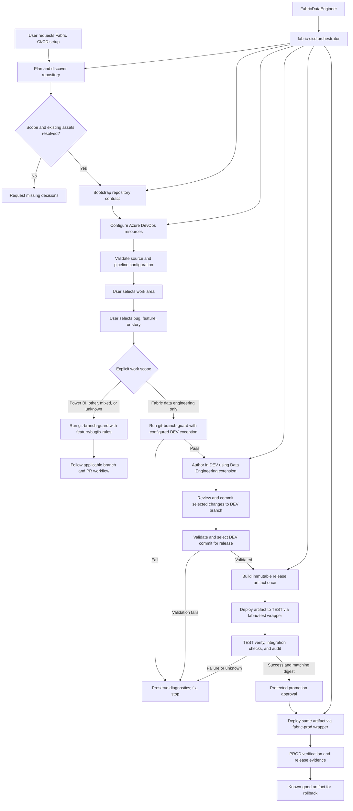

## Context

The existing Fabric and DevOps plugins provide workload skills and PR behavior. The reference Analytics Reporting `cicd/` directory at commit `db118e88dff09f5c422a4351eeb024d8ba539cf0` contains assets to adapt for this lifecycle.

See `proposal.md` and `specs/fabric/cicd-lifecycle/spec.md` for the motivation and behavior contract. The separate drift-gate change is outside this lifecycle.

## Goals / Non-Goals

**Goals:**

- Provide one orchestrator with explicit modes for planning, bootstrap, configuration, validation, release, status, and rollback guidance.
- Separate reusable lifecycle code from repository-local manifests, source layouts, workspace mappings, Fabric Git connection evidence, and identity references.
- Reuse source validation locally and in trusted Azure Pipelines.
- Make repository and Azure DevOps setup idempotent, diffable, and recoverable.
- Preserve direct Fabric data-engineering authoring in DEV, a deliberate release from a reviewed DEV commit, protected TEST validation, and protected PROD deployment.

**Non-Goals:**

- Automatically deciding workspace IDs, service principals, branch-policy scope, or production approvals.
- Writing to DEV from validation or release pipelines; restricting ordinary interactive DEV authoring or execution.
- Moving data rows, schedules, credentials, or generated companion artifacts through Git.
- Replacing specialist Fabric workload skills or the generic branch/Jira guard.

## Decisions

### Architecture Diagram



### 1. Make `fabric-cicd` a staged orchestrator

The skill will expose a stable command/mode contract while keeping each stage independently testable:

- **Plan/status:** read repository files and Azure DevOps/Fabric metadata; produce a plan or compliance report without writes.
- **Bootstrap:** render missing repository assets from versioned templates and show file diffs before replacing existing content.
- **Configure:** apply only approved Azure DevOps policies, environments, protected resources, and permissions; return resource IDs and status.
- **Validate:** run manifest, source, secret, dependency, and pipeline checks.
- **Release:** create a revision-bound immutable artifact after validation.
- **Rollback guidance:** identify and, only after normal approval, redeploy a known-good artifact.

The orchestrator delegates workload-specific implementation to existing Fabric skills. Scope-aware branch handling permits direct DEV commits only for explicitly identified Fabric data-engineering work; the generic branch/Jira guard remains responsible for feature/bugfix and Jira rules for Power BI and other work. Mixed work follows each scope’s rules; ambiguity is not an exemption.

**Alternative rejected:** a single all-or-nothing setup command. It would make read-only discovery impossible, mix repository writes with external writes, and make partial recovery difficult.

### 2. Use a manifest as the repository adapter boundary

Each adopter supplies a `cicd/managed-items.yml` contract describing source root, DEV, TEST and PROD workspaces, managed items, dependencies, exclusions, the DEV branch mapping, and protected TEST and PROD identity references. Record the DEV workspace Git connection, branch/path, initial synchronization direction/result, and source revision. Validate the contract before creating pipelines and pass it to the release builder and deployment runner.

The bootstrap stage may create a starter manifest only when the user supplies or confirms the workspace and managed-item mapping. It cannot infer a production identity from a display name or silently include all workspace items.

**Alternative rejected:** scanning the workspace and automatically managing every item. That creates an unsafe deployment scope and makes generated SQL endpoints, schedules, and data rows indistinguishable from deployable definitions.

### 3. Separate repository generation from Azure DevOps control-plane configuration

Repository setup renders CI/CD YAML, validation/release scripts, dependency locks, and documentation. Azure DevOps setup uses a separate adapter for path-scoped build-validation policies, environments, service connections, protected variable groups/Key Vault references, agent-pool authorization, and protected checks. The adapter first reads current state, displays a plan, and applies only a minimal idempotent diff after confirmation. Fabric and Power BI policies remain separately scoped, and Jira remains the default work-tracking integration rather than Azure Boards.

Secret values are never generated, copied into Git, or printed. The adapter accepts references to protected resources and verifies their existence/authorization without exposing values. If the user declines an external write, the repository plan remains usable and manual configuration steps are returned.

**Alternative rejected:** encoding Azure DevOps resource IDs or secret values in repository templates. That would couple the reusable skill to one tenant and create credential leakage risk.

### 4. Implement the reference pipeline topology as distinct trust zones

The generated lifecycle follows these stages:

1. Author in the DEV workspace using the Data Engineering extension and commit resulting source to the DEV branch.
2. Review pending workspace changes, commit the intended supported items to the configured DEV branch, validate source, and deliberately select a DEV commit for release.
3. Build one immutable artifact from the exact selected DEV commit.
4. Deploy and verify the artifact in protected TEST.
5. Bind TEST verification and approval to the digest, then deploy the same artifact to protected PROD and retain evidence.

Adapt the reference's `fabric-release-stages.yml` into shared build/package/deploy/verify/audit behavior and thin `fabric-test.yml` and `fabric-prod.yml` wrappers; the reference's `fabric-dev.yml` is an input to adapt, not a generated DEV release. Each target supplies workspace, protected environment, service connection/identity, audit scope, parameters, and its write guard (`ALLOW_FABRIC_TEST_WRITE` or `ALLOW_FABRIC_PROD_WRITE`). The shared logic verifies the immutable artifact and installs pinned dependencies. TEST deployment is repeatable and metadata/definition-only; configured execution/integration checks run in TEST without transporting rows, credentials, schedules, triggers or generated endpoints as release content. Release pipelines must reject the DEV workspace as a deployment target.

Illustrative wrapper contract (parameters are resolved from approved adopter configuration, not hard-coded):

```yaml
# fabric-test.yml; fabric-prod.yml selects the equivalent PROD values
extends:
  template: fabric-release-stages.yml
  parameters:
    targetEnvironment: TEST
    targetWorkspace: ${{ variables.fabricTestWorkspace }}
    protectedEnvironment: fabric-test
    serviceConnection: ${{ variables.fabricTestServiceConnection }}
    writeGuard: ALLOW_FABRIC_TEST_WRITE
```

The shared pipeline builds once and passes the stored artifact and digest to TEST and PROD; separate wrappers cannot independently build or implicitly select a newer artifact. The example is illustrative and must be rendered and validated against the actual Azure Pipelines template contract during implementation.

Secretless source validation does not obtain Fabric deployment identities. PR validation for other scopes remains subject to their existing policies.

The DEV workspace is the shared authoring environment. The Data Engineering extension edits workspace items; the operator reviews pending workspace changes and uses Fabric Git integration to commit selected supported items to the configured DEV branch. Validate and deliberately select the exact DEV commit for release, checking that it contains the intended scope and accounting for pending or unfinished workspace changes. Later workspace changes do not change that release. No feature/bugfix branch, PR, export-based synchronization, or DEV drift gate is required for this Fabric data-engineering scope. Confirm supported Git and deployment item types; explicitly report unsupported items and dependencies.

**Alternative rejected:** requiring a separate export, file overwrite and drift gate after DEV authoring. This duplicates the source-control workflow.

### 5. Treat release artifacts as the deployment source of truth

The release builder packages the selected DEV revision, resolved manifest, dependency versions, source definitions, and content hashes. The deployment runner verifies those hashes and the approved target identity before writing. It does not checkout a newer revision or rebuild from a mutable workspace. TEST and PROD wrappers consume the same artifact. Partial deployment records affected items and stops dependent work so that rollback can use the last known-good artifact.

**Alternative rejected:** deploying directly from the Git working tree on the agent. That makes retries non-reproducible and prevents proving which source revision reached PROD.

### 6. Review and validate the DEV release revision

The DEV branch contains the reviewed definitions produced by Fabric data-engineering authoring. Establish the workspace-to-branch mapping and initial baseline explicitly. Review the pending workspace changes and the selected commit, validate its source, and start a release deliberately only after the intended work is ready. Direct DEV commits require compatible Git permissions and branch policy. Power BI and other work retain feature or bugfix branches and their existing PR policies.

**Alternative rejected:** additional export-based reconciliation and drift gating would duplicate synchronization already performed by the authoring workflow.

### 7. Integrate with the existing Fabric orchestrator and DevOps helper

`FabricDataEngineer` routes cross-workload CI/CD requests to `fabric-cicd`. The current `git-branch-guard` skill triggers before Fabric development, rejects `dev`, and its PowerShell script requires a feature/bugfix prefix and Jira key. The DevOps agent also invokes the guard before its work-category gate, while Jira and troubleshooting workflows hand off to the guard. These entry points must be reconciled, not merely bypassed in the lifecycle orchestrator.

Ask the user for work area first and then bug, feature, or story before branch routing. A Fabric data-engineering bug uses the same eligible DEV route as a feature or story; unresolved choices stop routing. Resolve explicit work scope before branch routing. The existing broad `Fabric Development` category alone is insufficient to establish the narrower data-engineering exception. The guard remains mandatory and receives explicit scope plus the configured DEV branch; it may pass that branch only for Fabric data-engineering-only work. Missing, unknown, or mixed scope follows the existing feature/bugfix rules, and main, prod, test and other protected branches remain blocked. Jira ticket handling remains independent: a DEV branch need not contain a Jira key, but applicable Jira intake and traceability are preserved. The direct-DEV route applies to the adopter project and workspace, not to implementation of this plugin itself.

Update the skill instructions and `check_git_branch_guard.ps1` contract together, and reconcile the DevOps agent definitions (`.agent.md` and `.toml`), `jira-workflow`, `troubleshooting-workflow`, and other discovered invocation points. Keep non-Fabric PR behavior unchanged. Git permissions and Azure DevOps policies are separate enforcement boundaries; this agent guard alone cannot enforce path-level restrictions on direct commits.

The related `fin-2060-fabric-de-branch-guard` change owns guard and Jira-intake implementation; this lifecycle integrates its contract. Apply skill-creator guidance to the Fabric lifecycle skill and its triggers and handoffs, and verify discovery and equivalent user choices separately in Codex, GitHub Copilot, and Claude. Use each harness’s supported mechanisms and a plain-text fallback; report unavailable harnesses as unverified.

### 8. Co-locate source while separating workspaces and release scopes

The standard repository may contain `fabric/` and `pbi/` roots. Fabric uses its own DEV, TEST and PROD workspaces, manifest, identities, and release pipeline; Power BI retains separately configured mappings and an independent release pipeline. Power BI assets require a separate explicit mapping before generating release assets.

The lifecycle will model cross-domain dependencies explicitly: a Power BI release may depend on a successful Fabric release when the semantic model or report consumes Fabric-managed data, but the two pipelines remain independently approvable and independently scoped. A repository containing `pbi/` alone does not cause Fabric or Power BI deployment configuration to be inferred from folder presence.

**Alternative rejected:** one shared workspace or one combined credentialed pipeline. That would couple release permissions, make rollback ambiguous, and allow an unrelated Power BI change to mutate Fabric deployment state.

### 9. Keep runtime configuration protected and target-specific

Repository configuration may declare non-secret references to the approved service connections, protected variable groups, Key Vault-backed variables, pinned tool versions, agent queue, and target workspace IDs. A preflight must verify the protected resource can retrieve the required secret without logging its value before release readiness is granted. Secret values remain in protected Azure DevOps resources. TEST and PROD wrappers use separate environments, target-specific deployment identity/service-connection references and write guards, while the shared stages accept only the resolved artifact and target contract. Verification and audit scripts must work for both targets and must fail closed when the target guard, protected identity, or required agent authorization is absent.

### 10. Ship the complete reference as a parameterized starter bundle

Inventory every tracked file at the reference commit and document its source, disposition, modifications, and tests. Package reusable code and templates with the skill; adopters do not need the reference checkout or network access to render the bundle. The initial disposition is:

| Reference files | Disposition |
| --- | --- |
| `dev_drift_gate.py` | Record as not applicable to this lifecycle; do not generate a mandatory drift gate. |
| `auth_check.py`, `build_release.py`, `deploy_artifact.py`, `deploy_runner.py`, `post_deploy_check.py`, `record_release.py`, `secret_scan.py`, `validate.py`, `validate_config.py`, `validate_powerbi.py`, `verify_deployment.py` | Port and generalize runtime and validation code; assess dependencies and close the gaps in this design before use. |
| `fabric-dev.yml`, `fabric-prod.yml`, `fabric-release-stages.yml`, `fabric-validation.yml`, `validation-steps.yml`, `powerbi-prod.yml`, `powerbi-validation.yml`, `powerbi-validation-steps.yml`, `keyvault-connectivity-test.yml` | Adapt the DEV wrapper into TEST and include parameterized, mutually compatible pipeline templates; do not generate a DEV deployment wrapper. Power BI assets retain their independent architecture and render only for explicitly approved Power BI scope. |
| `config.yml`, `managed-items.yml`, `parameter.yml`, `pbi-assets.yml` | Convert to starter configuration templates using explicit adopter mappings; omit project names, IDs, item lists, and secret values. |
| `requirements-fabric-cicd.txt`, `requirements-fabric-cicd.lock` | Port and review as versioned dependency inputs; validate compatibility and preserve pinning. |
| `README.md`, `branch-policies.md` | Adapt into generic operator guidance; omit reference-specific run records, identities, and environment details. |

Bootstrap gathers an explicit scope contract, renders a compatible bundle, validates placeholders and cross-file references, and provides an offline validation entry point. Parameterize paths, branches, identities, and workspace mappings without copying tenant-specific details.

### 11. Bind trusted execution and release evidence

PR validation uses secretless source checks. Protected deployment identities are available only to authorized release stages; PR changes must not execute with those identities.

Build once from the selected validated DEV revision in a trusted producer, retain the immutable artifact and its digest in an access-controlled artifact store, and bind successful TEST verification, approvals, and PROD deployment to that digest and producer/run identity. PROD retrieves the TEST-verified artifact, not a second build from its own branch; TEST failure, missing or mismatched evidence blocks promotion. Retention must cover promotion and the configured rollback window. Target verification compares supported managed definitions and dependencies against the artifact and includes configured TEST execution/integration checks. Status and evidence record target, digest, verification result, and promotion history. Track owned inventory and explicit tombstones; rollback selects a known-good digest, requires normal protected approval, preserves unmanaged resources and does not delete newly introduced managed items unless an approved deletion plan explicitly authorizes them, then verifies the resulting state and reports any residual items.

### 12. Exercise the lifecycle with PREQIN-1

After offline template and fixture tests pass, use `C:\Development\PREQIN-1` as the named live adopter. First inventory its source definitions and dependencies, establish an explicit supported managed scope, and report unsupported items rather than silently omitting them. The repository contains Lakehouse, notebook, pipeline, semantic model, report, data agent, and Copy Job assets; their presence does not imply all are supported or approved for deployment. Resolve workspace names, capacity, target branches, source roots, deployment dependencies, and protected resources before creation or deployment.

Use `fab` to create dedicated DEV, TEST and PROD workspaces on the selected capacity and grant Power BI EOT (Service Principal) Contributor on all three: application ID `e4b14c44-12a7-4882-a5ed-dbcb036c9d7b`, service-principal object ID `97937f89-9a24-49f4-a3be-c757d283b03d`. Verify roles using the object ID and retain identifiers only in adopter-specific evidence. Configure protected TEST and PROD identities.

Bootstrap PREQIN-1, establish the DEV workspace-to-branch baseline, exercise extension authoring, review and commit selected items to DEV, then select and build the validated DEV revision once. Deploy and verify it in TEST and promote the same digest through protected PROD.

### 13. Generate once for an explicitly selected target

The versioned plugin bundle owns executable generators, templates, dependency inputs and instructions; adopter repositories provide non-secret target and managed-item configuration and retain generated outputs. Do not recreate notebooks or pipeline business logic by hand. Package versioned definitions from the reviewed source revision; apply target bindings through validated configuration. Repeat generation must preserve unrelated files, show conflicts and require an explicit update decision.

Require an explicit workspace name or ID and, for creation, an approved capacity. Plan and status remain read-only: report a unique missing target as a planned create with pending IDs, and reject ambiguous, incompatible or unauthorized targets. A rehearsal workspace is a separate selected target, not a fourth permanent environment or an implicit replacement of TEST. Resolve and compare actual IDs to DEV, TEST and PROD before protected writes. Rehearsal verification cannot by itself authorize production promotion unless the promotion contract explicitly approves that exact target and evidence.

Verify schema-enabled Lakehouse and endpoint readiness, managed inventory, approved identity and connection permissions. After deployment verify notebook default Lakehouse bindings and pipeline workspace, Lakehouse and connection references, including encoded references; stop on unresolved or unintended destinations. Protect deployment through final verification using an exclusive target lock. Keep schedules disabled and run source ingestion and integration checks only on explicit selection. Runtime checks can write target data; release artifacts never transport data rows.

Finalize reviewed generated inputs, capture the resulting commit, queue a trusted build for that exact revision and deploy its one immutable artifact. Bind source revision, target contract, artifact digest, identity, run and verification evidence. Require approved evidence location and retention before protected release and recheck mutable state on resume.

For initial data engineering, use Spark notebooks as the primary authoring surface for schemas, Delta transformations, validation and materialized tables; use pipelines for ingestion and orchestration. SQL-authored procedures or views are an explicit extension. Restore definitions with a retained known-good artifact under the same protected approval and verification. Delta data recovery is a separate reviewed action with an explicit recovery point and scope; never delete unrelated or residual managed items without an approved deletion plan.

## Risks / Trade-offs

- **Bootstrap changes differ from a repository's conventions** → Render to a temporary plan, show diffs, validate existing assets, and require explicit confirmation before replacement.
- **Azure DevOps permissions vary by tenant/project** → Separate read/plan/apply phases and report exact missing protected resources instead of guessing permissions.
- **Workspace metadata is incomplete or ambiguous** → Stop at planning and require explicit mappings; never infer PROD from DEV or by display name alone.
- **A pipeline stage is unavailable** → Fail the affected gate closed, preserve reports, and keep unrelated source validation diagnosable rather than claiming overall readiness.
- **CLI and export formats change** → Pin the trusted CLI dependency, keep type handlers version-aware, and fail on unsupported definitions.
- **Large managed scopes slow validation** → Process manifest items independently and provide item-level progress and explicit scope selection.
- **Rollback artifact is valid but target state has changed** → Re-run target preflight and protected approval before rollback; never treat artifact validity as authorization to write.

## Migration Plan

1. Inventory and port applicable reference `cicd/` assets; document the drift comparator as not applicable to this workflow.
2. Add manifest/configuration schema validation and repository template rendering using the reference README asset map.
3. Add plan/diff/apply adapters for Azure DevOps policies and protected resources, starting with read-only discovery and dry-run output.
4. Implement secretless validation, build-once artifact promotion, protected deployment and verification; validate with synthetic fixtures.
5. Integrate scope-aware `FabricDataEngineer` routing and the DEV branch exception while retaining existing branch/Jira and PR behavior for other work.
6. Bootstrap the reference Analytics Reporting project in report-only mode, reconcile its existing `cicd/` assets against TEST/PROD shared release stages, target guards, and verification, and record intentional deviations including replacement of its DEV rehearsal.
7. Enable governance writes and branch policies after an approved plan, resource connectivity checks, and end-to-end validation.
8. Roll back by disabling generated policy references and removing only lifecycle-owned templates/configuration; retain existing source definitions and unrelated DevOps/Fabric skills.
9. Execute the PREQIN-1 exercise with dedicated workspaces and Contributor assignments; retain DEV commit, TEST and PROD evidence.

## Open Questions

- Which Azure DevOps organization/project/repository defaults should the reusable configure adapter accept when the adopting repository has multiple remotes?
- Which supported Fabric CLI version and agent pool should be pinned for the release templates?
