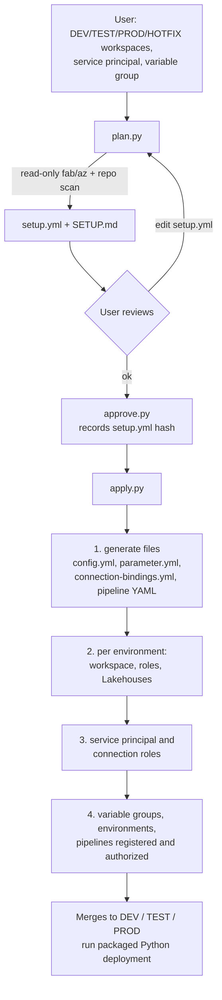

## Context

See proposal.md - Why. The current skill has a PowerShell entry point, a Python helper and TEST/PROD YAML that check out the repository and deploy with `ms-fabric-cli`; TEST triggers from the DEV branch. Analytics Reporting (`dfaa945`) has the working Python deployment scripts and a UAT-only bootstrap; Servicing Oversight (`e78fe32`) added Copy Jobs, connection bindings, the SQL endpoint rule and per-branch triggers during FIN-2101.

## Goals / Non-Goals

**Goals:** one obvious path (plan → review `SETUP.md` → approve → apply); scripts that do the same thing every time; reuse the reference scripts rather than write new ones.

**Non-Goals:** a generic step engine or state machine, numbered error catalogs, any change to `powerbi-cicd` or Power BI bindings (separate follow-up change), workload execution.

## Architecture Diagram

## Decisions

1. **`setup.yml` is the single source of truth; `SETUP.md` is rendered from it.** The user edits only `setup.yml` (if anything) and re-runs plan. Every generated file is derived from it, so two runs with the same `setup.yml` produce the same files. *Alternative:* separate config, manifest and bindings files edited by hand — rejected; that is where FIN-2101 drift came from.

2. **Approval = hash of `setup.yml`.** `approve.py` refuses when `SETUP.md` lists blocking gaps, otherwise writes the SHA-256 to `setup.approved`. `apply.py` recomputes and stops on mismatch. No other approval mechanism.

3. **`apply.py` is a plain ordered list of idempotent steps.** Each step checks current state, does only what is missing, prints what it did, and on failure exits non-zero with one message naming the cause and the fix. Re-running after a fix repeats completed steps as no-ops. No state file.

4. **Scripts come from the references.** Port per this table; all project names and IDs move to `setup.yml`.

   | Asset | Source | Use |
   |---|---|---|
   | `deploy_runner.py`, `deploy_artifact.py`, `release_contract.py`, `build_release.py`, `auth_check.py`, `record_release.py` | Analytics Reporting | Packaged deployment |
   | `validate.py`, `validate_notebooks.py`, `validate_config.py`, `secret_scan.py` | Analytics Reporting | PR and build validation |
   | `compare_release.py` | Analytics Reporting | TEST→PROD digest gate |
   | `dev_drift_gate.py` | Analytics Reporting | Optional DEV vs repository check |
   | `uat_bootstrap.py` workspace, capacity, role, Lakehouse and Azure DevOps authorization functions | Analytics Reporting | `apply.py` step 2 and 4, for any environment; UAT lock, defaults, PAT and runtime execution dropped |
   | Copy Job handling, `connection-bindings.yml`, `$sqlendpointid` rule, TEST-branch trigger with PROD consuming the TEST artifact | Servicing Oversight | Templates and generator |
   | Inline YAML archive verification | Both | Moved into `deploy_artifact.py`, run before any other packaged import |

5. **One promotion topology.** DEV branch → DEV, TEST branch builds and deploys TEST, PROD branch consumes the TEST artifact after the digest check. This is the FIN-2101 topology proven in builds 17399–17401. Branch names come from `setup.yml` (defaults `DEV`/`TEST`/`PROD`). *Alternative:* also support build-once-from-DEV — rejected to keep one path.

   **Hotfix:** a `fabric-hotfix.yml` pipeline triggers on `hotfix/*`, builds once and deploys to the HOTFIX workspace (a fourth environment key in `setup.yml`, `config.yml` and the generated `parameter.yml`, so dynamic references resolve to HOTFIX items). The PROD pipeline checks the merged pull request's source branch: `hotfix/*` → download the hotfix pipeline's artifact for that branch tip; anything else → the TEST artifact. Any other source with no matching artifact blocks. `SETUP.md` includes the forward-port steps to TEST and DEV. *Alternative:* validate hotfixes in TEST when it is clean, rejected because "clean" is a judgment call.

6. **`parameter.yml` is generated.** `plan.py` lists DEV items, computes each item's Fabric Git logical-ID form, scans managed definitions for GUIDs, and maps matches to `$workspace.$id`, `$items.<Type>.<Name>.$id` or `$items.Lakehouse.<Name>.$sqlendpointid`; the all-zero placeholder maps to `$workspace.$id`. Unmatched GUIDs appear in `SETUP.md` as gaps unless excluded in `setup.yml`. Output is sorted.

7. **`SKILL.md` is a numbered command list:** run plan with `--no-prompt`; if it prints questions, ask the user each one and re-run plan with the answers; show `SETUP.md` to the user, approve on their confirmation, run apply, commit the generated files, open the DEV PR. If a script fails, show its message to the user and stop.

8. **Service principal and variable groups are inputs; secrets stay manual.** Plan takes the service principal application ID and variable-group name (one shared value by default, overridable per environment), resolves the object ID with `az ad sp show`, and reads the group's variable names and secret flags only. Apply grants workspace and connection roles, grants the pipeline-invocation connection owner `Contributor` on TEST/PROD (FIN-2101 error 3125), creates missing Azure DevOps environments, and authorizes each pipeline for only its own group and environment. The variable names follow the Analytics Reporting templates (`FABRIC_TENANT_ID`, `FABRIC_APP_ID`, `FABRIC_APP_SECRET`). *Alternative:* create the variable group with the secret, rejected because setup must never handle secret values; a Key Vault-linked group is out of scope and noted in `SETUP.md` as an optional follow-up.

9. **Lookups, all read-only.**

   | Value | Lookup | If it fails |
   |---|---|---|
   | Tenant ID | `az account show --query tenantId` | Ask |
   | Workspace IDs, capacity | `fab api workspaces` (match name), `fab api workspaces/<id>`, `fab api capacities` | Ask for the workspace ID |
   | DEV items | `fab api workspaces/<id>/items` | Stop: DEV must be readable |
   | Lakehouse SQL endpoint | `fab api workspaces/<id>/lakehouses/<lhId>` → `properties.sqlEndpointProperties.id` | Ask |
   | Connections used | Scan managed definitions for connection IDs, then `fab api connections/<id>` | Ask for the display name; keep the ID |
   | Connection roles, owner | `fab api connections/<id>/roleAssignments` | Mark unknown; apply re-checks |
   | Workspace roles | `fab api workspaces/<id>/roleAssignments` | Mark unknown; apply re-checks |
   | Service principal object ID | `az ad sp show --id <appId> --query id` | Ask |
   | Azure DevOps org, project, repo | Parse `git remote get-url origin` | Ask |
   | Variable group variables | `az pipelines variable-group list --group-name <name>` (names and `isSecret` only) | Mark unknown; apply re-checks |
   | Pipelines, YAML path | `az pipelines list --name <name>` | Mark not registered |
   | Environments, pipeline authorization | `az devops invoke` on `distributedtask/environments` and `pipelines/pipelinePermissions` | Mark unknown; apply re-checks |
   | Fabric tenant allows service principals | Not looked up (admin only) | Manual prerequisite; `auth_check.py` proves it at deploy |

10. **Missing values are asked, not guessed.** Every value plan cannot look up has a fixed question and example in the script. Run in a terminal, plan prompts for each one. Run by an agent with `--no-prompt`, plan writes the open questions to `SETUP.md` and prints them, then exits non-zero; the agent asks the user each printed question and re-runs plan with `--answer <key>=<value>`. Answers are stored in `setup.yml` and shown in `SETUP.md` as "supplied by user". Defaults (branch names, environment names, shared service principal and variable group) are shown pre-filled so the user can accept or change them in the same pass.

## Risks / Trade-offs

- [`fabric-cicd` parameter syntax changes] → Pin the version; tests load generated rules through the library's real objects.
- [Logical-ID transform is undocumented] → Derive from observed pairs in both reference repos and cover with fixtures; unmatched IDs are gaps, never guesses.
- [Analytics Reporting's PROD pipeline rebuilds instead of consuming TEST] → Its re-generation will differ on that point; record as an expected difference and let the team adopt the single topology when convenient.

## Migration Plan

1. Land scripts, templates and tests; retire `Initialize-FabricCicd.ps1` and `bootstrap-config.json`.
2. Run plan against Analytics Reporting and Servicing Oversight with their real workspaces; compare generated files with the committed ones and record the differences as live-adoption evidence.
3. Rollback: the previous skill version stays installable; adopters' committed files are unaffected until they re-run apply.
