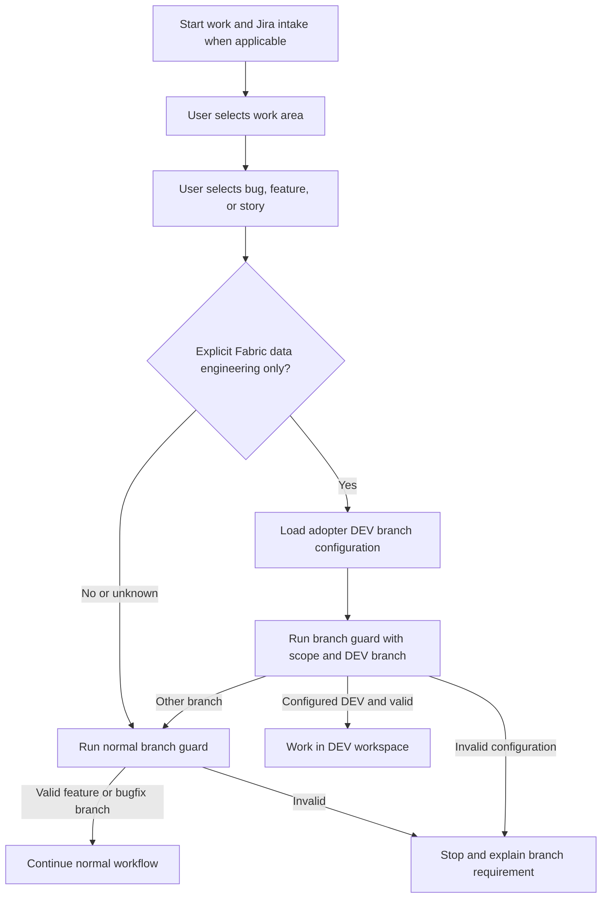

## Context

`git-branch-guard` currently runs before Fabric development and rejects shared branches including DEV; its PowerShell script has no scope input. The DevOps agent's ticket flow invokes the guard before presenting its broad work-category gate, and Jira and troubleshooting workflows also invoke it. See the proposal and capability spec for behavior. This change is related to `fin-2060-fabric-cicd-lifecycle`, which consumes the resulting route for adopter projects.

## Goals / Non-Goals

**Goals:**

- Validate a configured DEV branch for explicitly scoped Fabric data-engineering-only work while preserving existing validation for all other work.
- Keep scope, branch validation and Jira tracking consistent across every guard entry point.

**Non-Goals:**

- Deploying Fabric assets, changing Azure DevOps policies, or allowing direct DEV work on this plugin's implementation.
- Inferring data-engineering-only scope from a broad Fabric label, a branch name, or a Jira ticket.

## Decisions

## Architecture Diagram

### Scope and branch contract

Callers pass a bounded explicit scope and configured DEV branch to the guard; no-argument invocation retains current behavior. Validate that the configured branch is the permitted adopter working branch, that the current branch matches it, and that it is not main, master, prod, production or test before granting the exception. Other shared names remain protected unless they are the configured DEV branch. Git errors and detached HEAD fail closed. The exception changes branch naming checks, not Jira intake or remote permissions.

For every work area, obtain the Jira ticket key from the user and record it in `RESUME.md` so the commit workflow can identify the ticket regardless of branch name. When a ticket is missing, ask the user; do not infer it from the branch or invent one. Preserve the existing record when updating the current ticket. Jira integration fallback still captures the user-provided key. `SESSION_RESUME.md` remains a separate existing session record.

The intake asks the user first for the work area, then for the independent work type: bug, feature, or story. A Fabric data-engineering bug and a Fabric data-engineering story follow the same DEV branch route when scope is exclusively eligible. Ask for more specific scope when a broad area is insufficient; do not infer scope or type from Jira metadata. Unresolved selections stop routing. Perform both choices before branch selection and guard invocation. Preserve the existing report subtype and downstream planning gates. Audit `.agent.md`, `.toml`, `jira-workflow`, `troubleshooting-workflow`, and all other guard callers so no path still unconditionally creates a branch before scope is known. Existing branch-reuse logic still applies when a feature/bugfix branch is required.

**Alternative rejected:** skipping the guard for Fabric. It would leave branch state unvalidated and could accidentally authorize another protected branch.

### Cross-harness compatibility

Use skill-creator guidance when implementing or adapting skill instructions: define triggers, inputs, output and handoffs, and evaluate representative prompts and edge cases. Maintain equivalent behavior through Codex, GitHub Copilot and Claude using each harness’s supported skill/agent discovery and prompt mechanism. Do not assume Copilot-specific `.agent.md`, Codex `.toml`, a specific MCP tool name, or an interactive-choice API exists in every harness; provide an equivalent plain-text prompt and explicit unresolved-state behavior. Test discovery, intake order, both DEV and normal branch routes, and missing integrations separately in each harness. Report a harness as unverified if unavailable; do not treat documentation or another harness’s test as proof.

### Scope of the change

The adopter project explicitly configures the DEV working branch; do not apply this exception to development of this plugin. Implement the branch check in the guard's script and document the same contract in its skill, rather than placing policy in the Fabric endpoint code. The lifecycle change references this capability and should not duplicate ownership of guard implementation tasks.

**Alternative rejected:** identifying eligible work from paths, current branch, or broad ticket category alone. These do not reliably distinguish mixed work or Fabric data engineering from other Fabric development.

## Risks / Trade-offs

- **Shared DEV work overlaps** → Review selected workspace changes and release commit under the lifecycle workflow.
- **Broad or ambiguous scope grants an unintended exception** → Require explicit exclusive scope and default to normal branch checks.
- **Direct commits conflict with remote policies or affect other paths** → Report permissions/policy conflicts; local checks cannot enforce remote path restrictions.
- **Different agent entry points disagree** → Inventory and test each supported handoff and preserve behavior when optional inputs are absent.

## Migration Plan

1. Implement and test the guard contract with backward-compatible no-argument behavior.
2. Update all caller instructions and harness definitions to resolve scope before invoking the guard; retain normal branch reuse and Jira tracking.
3. Integrate the related Fabric lifecycle route and verify direct DEV permissions separately in the adopter repository.
4. Roll back routing and guard changes together if checks fail; existing remote policies remain unchanged.
