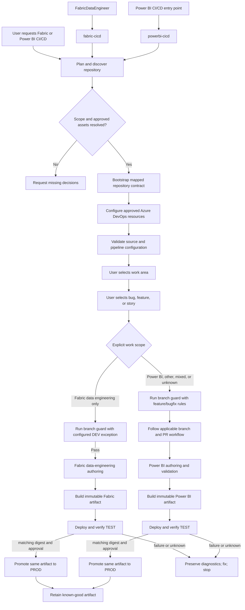

## Context

The existing `fabric-cicd` skill is intentionally a Fabric
data-engineering-only bootstrap. Its optional `pbi-assets.yml` validator
proves that Power BI mapping must be explicit, but it is not a Power BI
deployment implementation. The Glasslake `setup-fabric-cicd-environments`
change supplies the Power BI environment-bootstrap reference: an explicit
`pbi/` boundary, DEV Git integration, idempotent `fab` workspace setup,
Azure DevOps governance, Key Vault-backed deployment identity, sequential
readiness gates, pilot isolation, and immutable TEST/PROD promotion.

The new lifecycle must reuse those control-plane ideas without reusing
Glasslake resource names, identifiers, service-principal assumptions, or
Fabric data-engineering deployment behavior. See [proposal.md](proposal.md)
and the capability specification for the behavior contract.

## Goals / Non-Goals

**Goals:**

- Generalize the smallest connected Glasslake dependency set, preserve useful
  YAML compatibility, and present one Power BI setup flow with plan and
  recovery. Use PowerShell templates with `fab` and `az`, constrain all work
  to an explicit Power BI folder, and keep no project-specific identifiers or
  secrets as defaults.
- Give Power BI CI/CD first-class skill discovery and an independently
  testable setup/release contract.
- Preserve the common lifecycle shape: discover, map, plan, bootstrap,
  validate, build once, verify TEST, promote the same artifact, and retain
  rollback evidence.
- Reuse existing Power BI authoring, semantic-model, report-management,
  paginated-report, DAX-testing, and DevOps branch-routing capabilities at
  their established boundaries.

**Non-Goals:**

- Converting `fabric-cicd` into a mixed workload deployment tool, moving
  Fabric data-engineering content into the Power BI plugin, or changing the
  current branch-guard policy.
- Treating a mapping validator, repository folder, or discovered workspace as
  authorization to create resources or deploy.
- Supporting an item format merely by copying files or silently falling back
  to developer credentials, a different API, or an unsupported item type.
- Managing source data, refresh schedules, gateway configuration, capacity
  provisioning, or unrelated workspace content.

## Architecture Diagram



## Decisions

### 1. Add a sibling `powerbi-cicd` skill, not Power BI behavior to `fabric-cicd`

Create the Power BI lifecycle under `plugins/powerbi/skills/powerbi-cicd/`
with its own discovery metadata, source mapping, templates, commands, and
tests. It will cite the `fabric-cicd` documentation only for common lifecycle
concepts and update that skill's Power BI mapping note to point to the new
owner. The small existing `pbi-assets.yml` mapping contract becomes either a
migrated compatible input or a documented deprecation path, but is not left as
a Fabric-owned deployment mechanism.

This preserves the existing Fabric capability's explicit Power BI exclusion
and makes the skill trigger match the requested workload. Extending
`fabric-cicd` was rejected because it would combine unrelated item APIs,
permissions, source validation, and rollback contracts in one skill.

### 2. Use the Fabric-compatible PowerShell contract with Power BI extensions

`powerbi-cicd` will expose `Initialize-PowerBiCicd.ps1` with the same external
operator interface as `Initialize-FabricCicd.ps1`:

```powershell
Initialize-PowerBiCicd.ps1 -Mode Render|Plan|Apply|Status|Resume|Deploy `
  -ConfigPath <path> -ManifestPath <path> -RepoRoot <path> `
  -OutputRoot <path> -Target <UAT|TEST|PROD|REHEARSAL> -ArtifactPath <path> `
  [-AllowOverwrite] [-AllowTargetWrite]
```

The configuration preserves the shared `repository`, `azure_devops`,
`dev_workspace`, `targets`, `roles`, `pipelines`, and
`protected_resources` sections. TEST and PROD are required profiles; UAT and
REHEARSAL are the only optional deployment profiles. Each optional profile
must declare its workspace, pipeline, protected resources, artifact route,
and verification policy. The configuration changes `fabric_source_folder` to
`powerbi_source_folder`, and its manifest maps supported Power BI assets,
report/model dependencies, RDL bindings, and approved substitutions instead
of Fabric managed definitions. This is parameter-compatible at the setup
interface, not a claim that a Fabric manifest can deploy Power BI items.

The skill will first run read-only discovery. Its plan mode renders the
proposed source boundary and external actions with no writes; its apply mode
revalidates the approved contract before it creates or updates scoped Azure
DevOps resources. Developer-authenticated `fab` and `az` sessions provision
or verify the selected topology, direct role mappings, DEV Git binding, and
named pipelines. Protected service identities are deployment-only.

This mirrors the Fabric bootstrap's plan/apply discipline while avoiding an
assumption that `pbi/` or a workspace name is a deployable target. A broad
automatic scanner was rejected because it would make discovered source and
target state act as authorization.

### 3. Use the Glasslake gated environment topology as the bootstrap baseline

The reusable default is an approved DEV workspace bound only to the configured
Power BI folder and DEV branch, with required TEST/PROD and optional
UAT/REHEARSAL targets Git-disconnected and updated by a validated artifact.
Each configured non-DEV target has its own workspace, generated and registered
pipeline, target guard, environment mapping, verification policy, and
non-secret evidence. The bootstrap has five gates: repository, workspace,
identity-and-secret, governance, and pilot. Every gate records non-secret
evidence and prevents the next phase after a failure. A configured adopter
repository is the source of truth; copying a source repository into a
dedicated CI/CD repository is an explicit configuration decision, not a
hardcoded Glasslake behavior.

This takes the safety model from the Glasslake implementation without
embedding its workspace names, branches, Key Vault names, or capacity. Direct
Git synchronization to TEST or PROD was rejected because it would bypass
artifact provenance and approval evidence.

### 4. Treat the Power BI adapter as a supported-item boundary

The release adapter will expose stable `validate`, `package`, `preflight`,
`deploy`, and `verify` operations for the item formats explicitly approved in
the contract. It will determine the tenant-supported Power BI/Fabric API or
client operation during read-only preflight and retain a tested supported-item
matrix. Semantic models deploy before reports; RDL deployment requires an
explicit data-source/model contract. Any item without a safe approved path
remains a blocking, classified result.

This follows the Glasslake design while avoiding generic REST wrappers and
file-copy "deployment." The exact implementation client is intentionally not
committed until its support and least-privilege behavior are verified against
the target tenant; this does not change the fail-closed external contract.

### 5. Separate offline PR validation from protected releases

Pull-request jobs run only local PBIP/PBIR/TMDL/RDL structure checks,
dependency analysis, configuration checks, committed-secret scanning, and
eligible source-only DAX checks. They do not load protected variable groups,
use the deployment identity, or connect to a workspace. Trusted stages resolve
the approved runtime identity only after preflight and never log secret
values. Environment mappings and named secret references remain reviewable;
credential values stay in Key Vault or the approved protected system.

Using one credentialed pipeline for all checks was rejected because it would
grant untrusted source changes access to deployment capability.

### 6. Build once and promote by verified digest

The post-merge pipeline packages the approved source subset, non-secret
configuration, dependency lock, manifest, revision, and content hashes once.
Each configured UAT, TEST, PROD, or REHEARSAL stage verifies that artifact
before writes. TEST validation produces the evidence and digest required for
protected PROD promotion; UAT or REHEARSAL is an independently configured
pre-production route and cannot substitute for TEST. Azure DevOps
environments carry target-specific approval and exclusive-lock controls. The
pipeline never rebuilds from a different checkout for a deployment target.

This resolves the Glasslake concern that a production result could differ from
the reviewed revision. Per-environment rebuilds were rejected because they
weaken provenance and make rollback evidence ambiguous.

### 7. Consume existing specialist and DevOps boundaries

The new skill will hand PBIP/PBIR validation to the existing Power BI project
and report-authoring capabilities, semantic model changes and verification to
semantic-model authoring, RDL-specific work to paginated-report authoring, and
approved DAX execution to the existing test framework. It will invoke the
DevOps/Jira and `git-branch-guard` route before implementation work, passing
Power BI scope so the established normal feature/bugfix policy applies. It
will not duplicate branch policy, authoring implementation, or test
frameworks.

The lifecycle acts as the coordinator of release evidence, not as a new
general Power BI authoring agent. Altering `FabricDataEngineer` to own Power
BI work was rejected because its present contract is expressly
data-engineering-focused.

### 8. Verify live state, preserve evidence, and recover by redeployment

After each deployment, verification compares the manifest with live managed
items, model/report bindings, configured substitutions, model readiness, and
applicable RDL bindings. The audit record identifies source revision, hashes,
environment, workspace, identity reference, approval, timing, changed scope,
and result. Unexpected drift blocks promotion. Recovery selects a prior
known-good artifact and runs the same protected route; it does not converge or
delete arbitrary workspace items.

This makes partial failure observable and preserves unrelated content. Direct
manual rollback or destructive workspace synchronization was rejected because
it bypasses evidence and risks unmanaged items.

## Risks / Trade-offs

- [Power BI API support varies by item type and tenant] → maintain a
  supported-item matrix; preflight the approved operation read-only; fail
  closed before writes for unsupported formats.
- [PBIR/TMDL and RDL dependencies can be indirect] → require explicit
  contracts when static analysis cannot resolve a binding and block ambiguity.
- [The same release concepts appear in two skills] → share lifecycle terms and
  cross-links, but keep workload-specific source, deployment, and rollback
  implementations separate.
- [Protected identity can be over-permissioned] → use explicit target mapping,
  per-environment least privilege, read-only preflight, and redacted evidence.
- [Cross-harness discovery may drift] → make source-owned skill metadata and
  targeted Codex, Copilot, and Claude discovery checks part of acceptance.

## Migration Plan

1. Inventory the Glasslake bootstrap assets and current Power BI plugin
   capabilities; classify the smallest connected reusable dependency set.
2. Implement the Fabric-compatible PowerShell interface and non-secret base
   configuration, with a Power BI manifest and a compatibility transition for
   the existing optional mapping template.
3. Implement the sequential repository, workspace, identity, governance, and
   pilot gates; validate generated contracts and focused fixtures before any
   external write path is enabled.
4. Implement a supported, tenant-verified deployment adapter and protected
   Azure DevOps YAML for a synthetic non-production adopter; retain live
   target operations behind explicit operator selection.
5. Exercise the exact artifact through TEST verification, approved PROD
   promotion, drift blocking, and known-good rollback. Record unavailable live
   evidence as unverified.
6. Update Fabric, Power BI, DevOps, and multi-harness documentation; remove
   stale ownership language only after the new skill is validated.

Rollback of this capability is disabling its generated deployment pipeline and
restoring the previous skill/documentation revision. Rollback of a release is
redeployment of a retained known-good artifact through the same protected
route.

## Open Questions

- Which supported Power BI/Fabric service operation is available for each
  current PBIP/PBIR/TMDL and RDL item family in a representative non-production
  tenant?
- Does the existing `pbi-assets.yml` contract have external adopters that
  require a compatibility period rather than an immediate relocation?
