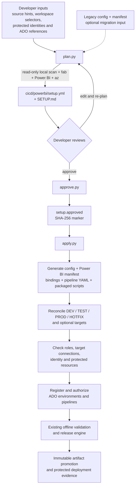

## Context

See `proposal.md - Why`. The current `powerbi-cicd` skill validates and packages Power BI source correctly, but setup starts from hand-authored `bootstrap-config.json` and `powerbi-assets.yml`, routes through `Initialize-PowerBiCicd.ps1`, and renders an approval JSON that a developer must edit by hand. The release scripts and templates already provide immutable packaging, dependency order, artifact verification, HOTFIX artifact selection, model ownership transfer, connection preflight, protected deployment, and evidence. The completed Fabric setup change provides the operator model to reuse: read-only plan, human-readable review, hash approval, and idempotent apply.

## Goals / Non-Goals

**Goals:**

- Give Power BI adopters one deterministic setup path: `plan -> review SETUP.md -> approve -> apply`.
- Generate all Power BI source, dependency, binding, target, and pipeline inputs from one `setup.yml`.
- Reuse the existing Power BI release and adapter behavior rather than reimplementing it.
- Make HOTFIX an explicit isolated setup target with its own workspace and protected resources while preserving HOTFIX use of the approved PROD release policy.
- Keep plan secretless and apply fail-closed under the invoking developer's existing sessions.

**Non-Goals:**

- Supporting Fabric data-engineering item types or merging the Fabric and Power BI setup domains.
- Replacing the existing Power BI artifact, dependency, binding, promotion, drift, recovery, or deployment engines.
- A generic workflow/state-machine framework, retries with hidden side effects, or a second credentials model.
- Live workload execution during setup.

## Architecture Diagram

## Decisions

1. **`setup.yml` is the source of truth and `SETUP.md` is rendered from it.** The setup records repository and Power BI source discovery, managed items, dependencies, all target environments, semantic-model and RDL bindings, substitutions, workspace and capacity references, Azure DevOps resources, protected identity references, private pool, WIF Key Vault metadata, role mappings, generated files, and blocking gaps. Defaults and user answers are tagged by provenance. If a developer changes a value, they re-run plan so derived mappings and the review record remain consistent. *Alternative:* continue to edit bootstrap JSON, manifest, and review JSON separately — rejected because it reproduces the FIN-2101 drift class the Fabric setup removed.

2. **Plan is a deterministic read-only compiler into the setup contract.** It accepts minimal repository and environment selectors, optionally imports validated legacy inputs, scans the approved source for PBIP/PBIR/TMDL/RDL boundaries and explicit dependencies, reads local item metadata, and performs read-only `fab`, Power BI, and `az` discovery. It never stores credentials or secret values. Lookups that cannot be completed become fixed questions with examples and are persisted under `answers` only after the user responds. `--no-prompt` prints those questions and exits non-zero for agent use; terminal use may prompt directly. *Alternative:* keep a generic `discover` report and require manual configuration completion — rejected because the agent remains responsible for deriving missing values and can interpret the same gap differently across runs.

3. **Power BI item, binding, and substitution generation remains explicit and fail closed.** Plan derives one managed item for each supported semantic model, report, or RDL under the approved source boundary. Local definitions supply stable IDs, paths, dependencies, report model references, RDL bindings, and connection references. Plan may surface substitution candidates, but only imported or explicitly answered rules become approved configuration. Generation preserves rule order, `find_replace` type, relative path or glob, exact find text, and replacement values as strings; it does not normalize, sort, coerce, or infer them. Workspace and Power BI reads resolve bindings to DEV, TEST, PROD, HOTFIX, and optional targets. Any unsupported item, duplicate logical ID, unknown connection, ambiguous report-to-model edge, missing RDL binding, incomplete substitution rule, or target-incomplete semantic-model binding is a blocking gap. Apply runs the existing `validate_manifest` and `validate_config` behavior over generated compatibility files before any external write. *Alternative:* permit best-effort partial manifests or inferred replacement rules — rejected because partial Power BI deployment can leave reports detached from models or silently point a model at the wrong environment.

4. **Generated files adapt to the existing release engine, not the reverse.** Apply creates the `bootstrap-config.json`-equivalent runtime configuration and `powerbi-assets.yml`-equivalent manifest only as generated compatibility artifacts consumed by `powerbi_cicd.py` and `deploy_adapter.py`. It also generates pipeline YAML and copies the reviewed validation/deployment helpers. The protected deployment job must first verify the immutable artifact and substitution coverage, then invoke the packaged `deploy_fabric.py`/`deploy_adapter.py` path with authenticated read-only inventory so ordered substitutions are applied to the extracted staging payload before dependency-aware deployment. A successful `deploy_artifact.py` verification is a gate, not deployment completion. The repository source, archive, content hashes, embedded manifest, and dependency lock remain unchanged. Their existing public behavior remains the release authority, so artifact package structure, dependency ordering, immutable digest checks, model ownership, connection checks, HOTFIX resolution, evidence, and rollback do not get duplicated in setup scripts. Once consumers are migrated, the compatibility names may be removed in a later change. *Alternative:* redesign the packaging format now — rejected because it increases blast radius without improving the requested setup workflow.

5. **Approval is exactly the SHA-256 of `setup.yml`.** `approve.py` refuses when questions or gaps remain, then writes `setup.approved` with a version and digest. `apply.py` recomputes the digest before its first external action. No approval is inferred from `SETUP.md`, pipeline review, or an edited approval flag. *Alternative:* preserve a manually edited `approval: approved` JSON field — rejected because the approval can become detached from the content actually used.

6. **Apply is one ordered, idempotent sequence with no general step engine.** The steps are: (1) revalidate approval and generated contract, (2) generate compatibility config/manifest, bindings, substitutions, pipelines, and packaged helpers, (3) create or reuse reviewed workspaces and reconcile direct roles, (4) validate protected identities, model source connections, and required connection access, (5) validate or create Azure DevOps environments, variable-group references, private pool, WIF Key Vault endpoint authorization, and named pipelines, and (6) render readiness evidence. Each step checks current state and becomes a no-op after success. Apply records only non-secret outcomes and never runs a deployment or workload. *Alternative:* a resumable state machine or reusable task runner — rejected as unnecessary complexity for a small deterministic command list.

7. **HOTFIX is configured as a separate deployment target with the PROD content environment.** `setup.yml` includes HOTFIX workspace, capacity, runtime identity, pipeline, guard, and protected resource references. Its target IDs and runtime access remain specific to HOTFIX, while semantic-model bindings and substitution values resolve through the approved PROD content mapping. Generation must not add or require a separate HOTFIX substitution value. The existing HOTFIX artifact-resolution logic remains authoritative: a reviewed `hotfix/*` build deploys only to HOTFIX, and PROD consumes that same validated artifact after the merge. *Alternative:* continue representing HOTFIX only as a pipeline profile while borrowing all PROD target data at execution time — rejected because that leaves the isolated workspace outside the setup and validation contract. Treating HOTFIX as an independent content environment is also rejected because it would change the production fix being validated.

8. **Protected deployment stays on the existing release path.** Generated jobs continue to perform offline PR/build validation, package once, verify archive member paths and hashes, use protected Windows execution where required, retrieve the client secret only at runtime through the configured WIF Key Vault service connection, verify identity and target guards, then invoke only packaged pinned Python helpers. Setup confirms endpoint and queue authorization but never reads the secret. *Alternative:* have apply use the protected identity to create the target — rejected because setup must remain a developer-session operation.

9. **Legacy configuration migration is import-only.** Plan can accept the legacy bootstrap JSON and Power BI manifest. It validates them, copies only explicit non-secret values into a draft setup, compares those values with read-only discovery, and turns invalid, missing, secret-bearing, or conflicting values into gaps. It never edits or deletes the legacy files during planning. Apply writes the generated files only after approval and keeps a rollback note describing the previous artifact locations. *Alternative:* auto-delete legacy files — rejected because operators need a low-risk rollback and evidence of what was reviewed.

10. **The skill becomes a numbered command list.** It asks for minimal selectors, runs plan with `--no-prompt`, asks every printed question, presents `SETUP.md`, requires explicit approval before `approve.py`, runs `apply.py`, then commits generated files and opens the normal Jira-keyed Power BI pull request. Script failures are shown verbatim and stop the workflow; completed steps are re-run as no-ops after correction. *Alternative:* preserve multiple PowerShell modes — rejected because each mode adds hidden control flow and different error behavior.

## Risks / Trade-offs

- [Power BI discovery returns incomplete connection or dependency data] -> Treat unresolved or ambiguous references as blocking gaps; never infer a target connection from display name alone.
- [Legacy inputs contain values incompatible with the new schema] -> Import explicit valid values only, report conflicts as questions, and preserve legacy files until a developer approves apply.
- [Generated compatibility artifacts drift from the retained release engine] -> Test round-trip generation and run the existing `powerbi_cicd.py` and `deploy_adapter.py` tests against generated fixtures.
- [YAML serialization or deterministic generation changes replacement semantics] -> Preserve every replacement as a string, retain rule order and exact text, and compare generated legacy-adopter manifests rule-for-rule before apply.
- [Generated pipeline verifies an artifact but never executes the Power BI adapter] -> Require a template integration test that verification is followed by the packaged deployment adapter and that the adapter receives the substituted staging payload.
- [HOTFIX target additions expose existing assumptions] -> Add HOTFIX to schema validation, binding completeness, protection maps, pipeline fixtures, and the existing hotfix resolution tests.
- [Read-only Power BI and Azure DevOps APIs are sensitive to principal permissions] -> Plan records a narrow named question for lookup failure and never retries with elevated credentials.
- [Apply partially succeeds before a later failure] -> Every step is idempotent and checks current state; rerunning continues as no-ops from the current external state without a hidden state file.
- [Generated setup includes a value whose field name resembles a secret] -> Enforce the existing recursive non-secret validator plus an allowlist for identity references; never permit token, password, client-secret, or connection-credential values.

## Migration Plan

1. Add the three setup scripts and schema, keep the existing release engine and Power BI templates active, and add unit fixtures that port the current bootstrap JSON and manifest into `setup.yml` without writes.
2. Add generated adapters for the current configuration and manifest shapes, including explicit HOTFIX target and protection entries, then run all existing offline release tests on generated artifacts.
3. Update `SKILL.md` to the numbered plan/approve/apply path and mark the PowerShell mode controller and hand-authored approval flow as migration-only until adopters have re-planned.
4. Run plan against synthetic PBIP, PBIR, TMDL, and RDL fixtures plus at least two synthetic legacy adopters; compare generated files with their reviewed legacy files and record only expected HOTFIX and setup-contract differences.
5. Retire the old bootstrap entry point and approval JSON after the migration tests pass and installer/catalog validation confirms that all harnesses expose the new commands. Rollback is to reinstall the prior skill version; already committed adopter release files remain usable until re-plan/apply is run.
