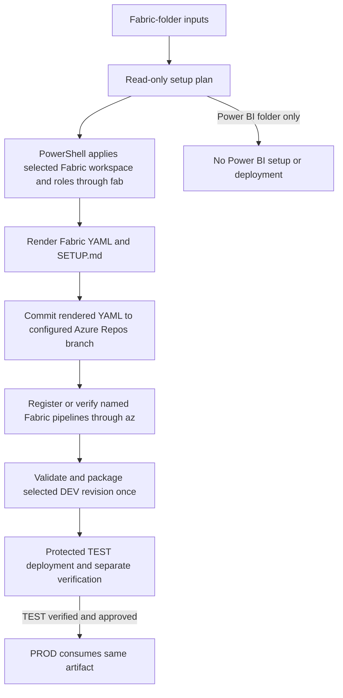

## Context

The Analytics Reporting snapshot `4a77113ec051907c3e10e6da9d4a89e62bfb58ea` contains a connected `create_uat.ps1` / `uat_bootstrap.py` workflow, UAT YAML, packaging and deployment scripts, YAML configuration and offline tests. Its PowerShell wrapper provides the intended operator shape; its bootstrap uses `fab` for workspace creation and fallback item shells, but retains reference-specific defaults and Python REST adapters that are not reusable as defaults. Thirty bootstrap tests passed against that checkout; live behavior has not been independently verified. The old plugin attempt is preserved at `archive/FIN-2060-lifecycle-attempt` (`dbcf31bbd02ed2ff47241706544134873609f9b6`); it has 77 Python scripts and 81 tests, but its audit records that pipeline creation and a coordinated setup are incomplete. Reuse only a few documentation or rendering helpers with mapped consumers.

## Architecture Diagram

## Goals / Non-Goals

**Goals:** Generalize the smallest connected reference dependency set, preserve useful YAML compatibility, and present one Fabric data-engineering setup flow with plan and recovery. Use PowerShell templates with `fab` and `az`, constrain all work to an explicit Fabric folder, and keep no project-specific identifiers or secrets as defaults.

**Non-Goals:** Deploy to DEV from release pipelines; silently execute workloads; require an extra source-only pipeline; recreate broad REST adapters or a large inherited test suite; configure Power BI CI/CD; treat UAT rehearsal evidence as automatic PROD approval.

## Decisions

1. **Reference-first, minimum-footprint implementation.** Start with the compatible wrapper, managed manifest, UAT pipeline, packaging, deployment, verification and only the focused tests needed to prove the generalized contract. Parameterize workspace, capacity, item, role, revision, protected-resource, Azure Repos and pipeline inputs. Borrow a prior documentation or rendering helper only after naming its consumer; do not bulk-copy the earlier Python adapters.
2. **One developer-authenticated PowerShell operator flow.** A PowerShell entry point accepts explicit inputs and offers a reviewable read-only plan and coordinated apply; status and resume support recovery. Its setup calls `fab` for Fabric workspace discovery/creation and role reconciliation (using `fab api` where required), and `az` with explicit organization, project, repository, branch, name and YAML path to register Fabric pipelines, all as the invoking developer's existing local identity. It verifies the local sessions first, accepts no tokens or client secrets, and never falls back to a service principal. Protected identities exist only inside TEST/PROD deployment jobs. It uses no generic REST client. Replace reference local plan persistence with explicit output selection to preserve read-only planning.
3. **Folder scope is the workload boundary.** The adopter declares a Fabric source folder and generated CI folder. Rendering, validation, packaging and Azure Pipeline path filters use those folders only. A Power BI folder is excluded and receives no template, registration or deployment action here; its independently approved bootstrap will own its folder and pipelines.
4. **Register, do not just render, Fabric pipelines.** Apply first verifies that the rendered YAML is committed to the configured Azure Repos branch. It lists the named pipeline and creates it with `az pipelines create` only when absent. A different repository, branch or YAML path is a blocking mismatch. Protected resources remain references that are verified and authorized separately; they are never copied into YAML or silently replaced.
5. **Keep source checks modest.** Reuse useful manifest, source and secret checks in the pipeline; they do not run notebooks. Preserve deployment and verification as separate outcomes. Manual verification follows a generated checklist; automated workloads run only when explicitly selected and authorized.
6. **Promote one artifact.** The reference TEST and PROD pipelines independently build. Adapt that topology to build once from the selected DEV revision, record its digest, verify it in TEST, and have protected PROD consume the same artifact after approval.
7. **Constrain packaged scope and honor DEV authoring.** Package only the configured Fabric definitions and required tooling, excluding data, secrets and Power BI files, and verify revision and hashes. An isolated rehearsal cannot replace TEST promotion evidence. Fabric releases require the DEV Git connection and initial baseline; the related branch-guard change owns scope-first routing.

## Risks / Trade-offs

- [Project-specific values are embedded in the reference] → Replace them with explicit inputs and test for reference-value leakage.
- [A rendered YAML file is not an Azure Pipeline] → Require a committed YAML source and idempotent `az` registration, with mismatches failing before changes.
- [Workspace role writes can be over-broad] → Require explicit object IDs, principal types and roles; inspect and read back only the selected mappings.
- [Promotion is a deliberate departure from the reference] → Test producer, digest, TEST evidence and PROD consumption together.
- [Offline tests cannot prove cloud permissions or runtime] → Keep separate evidence and report live steps unverified until exercised.

## Migration Plan

Implement and test the small generalized bundle in the plugin without modifying Analytics Reporting. Render a reviewable Fabric-folder starter for a synthetic adopter, commit its YAML only in that synthetic fixture, then exercise `fab`/`az` command boundaries with controlled tests; test both installed harnesses. Adopt existing repositories only after reviewing generated changes. Preserve a known-good artifact for protected rollback.
