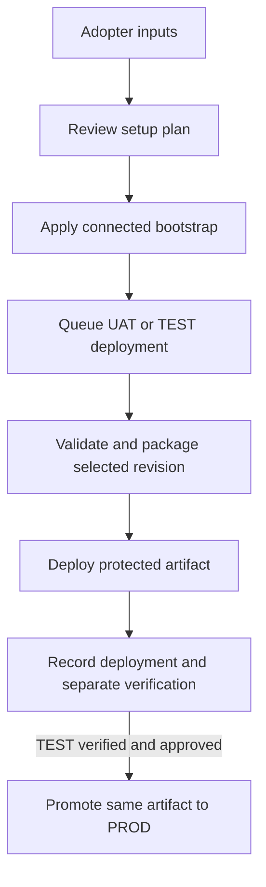

## Context

The Analytics Reporting snapshot `4a77113ec051907c3e10e6da9d4a89e62bfb58ea` contains a connected `create_uat.ps1` / `uat_bootstrap.py` workflow, UAT YAML, packaging and deployment scripts, YAML configuration and offline tests. Thirty bootstrap tests passed against that checkout; live behavior has not been independently verified. The old plugin attempt is preserved at `archive/FIN-2060-lifecycle-attempt` (`dbcf31bbd02ed2ff47241706544134873609f9b6`); its helpers are available via `git show` without copying the bundle into the new implementation.

## Architecture Diagram

## Goals / Non-Goals

**Goals:** Generalize the reference dependency set together, preserve useful behavior and YAML compatibility, and present one setup flow with plan and recovery. Keep no project-specific identifiers or secrets as defaults.

**Non-Goals:** Deploy to DEV from release pipelines; silently execute workloads; require an extra source-only pipeline; recreate unrelated CI/CD helpers; treat UAT rehearsal evidence as automatic PROD approval.

## Decisions

1. **Reference-first implementation.** Start with the bootstrap, wrapper, managed manifest, UAT pipeline, packaging, deployment, verification and tests as a compatible set. Parameterize their workspace, capacity, item, role, revision, protected-resource and pipeline inputs. Assess the checkpoint for individual useful implementations, but do not bulk-copy it. This maintains a working behavioral baseline.
2. **One operator flow.** A single entry point accepts explicit inputs and offers a reviewable read-only plan and coordinated apply; status and resume support recovery. Internal functions and protected pipeline stages remain separate where needed for testing or security. Replace reference local plan persistence with explicit output selection to preserve read-only planning.
3. **Keep source checks modest.** Reuse useful manifest, source and secret checks in the pipeline; they do not run notebooks. Preserve deployment and verification as separate outcomes. Manual verification follows a generated checklist; automated workloads run only when explicitly selected and authorized.
4. **Promote one artifact.** The reference TEST and PROD pipelines independently build. Adapt that topology to build once from the selected DEV revision, record its digest, verify it in TEST, and have protected PROD consume the same artifact after approval. Keep unrelated Power BI deployments separate and opt-in.
5. **Constrain packaged scope.** Reference packaging copies both entire trees; the generalized builder must include only the approved definitions and required tooling, exclude data and secrets, and verify the selected revision and hashes. An isolated rehearsal cannot replace TEST promotion evidence.
6. **Honor existing DEV authoring.** Fabric releases require the DEV Git connection and initial baseline. The related branch-guard change owns scope-first routing; this change consumes it rather than duplicating it.

## Risks / Trade-offs

- [Project-specific values are embedded in the reference] → Replace them with explicit inputs and test for reference-value leakage.
- [Promotion is a deliberate departure from the reference] → Test producer, digest, TEST evidence and PROD consumption together.
- [Offline tests cannot prove cloud permissions or runtime] → Keep separate evidence and report live steps unverified until exercised.

## Migration Plan

Implement and test the generalized bundle in the plugin without modifying Analytics Reporting. Render a reviewable starter for a synthetic adopter; test both installed harnesses. Adopt existing repositories only after reviewing generated changes. Preserve a known-good artifact for protected rollback.
