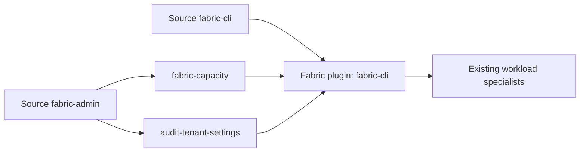

## Context

The destination has `plugins/fabric/skills/fabric-cli` with references and assets. The confirmed source has an expanded `fabric-cli` skill with scripts and references, plus `fabric-capacity` and `audit-tenant-settings` in the separate admin plugin. The latter includes audit scripts, metadata and references. Existing Fabric specialist skills and harness installation conventions remain relevant.

## Architecture Diagram

## Goals / Non-Goals

**Goals:** Integrate useful source guidance and dependencies, reconcile routing, and validate distribution across supported harnesses.

**Non-Goals:** Run tenant audits, change capacity state, deploy to Fabric, or copy unrelated source hooks and commands wholesale.

## Decisions

- Keep CLI guidance at its existing path and add the two admin skills under the Fabric plugin. This preserves the existing entry point and keeps capacity and audit workflows independently discoverable. A wholesale plugin replacement would discard destination-specific assets and routing.
- Compare overlapping files and port selected additions rather than overwrite; preserve destination-specific conventions and resolve conflicts explicitly. The source has harness-specific `.claude` paths, automatic upgrade advice and broad `-f` guidance that need adaptation to repository instructions and user authorization.
- Include referenced scripts and metadata only with their dependencies, portable paths and tested invocation. Document optional dependencies and route ownership overlaps with existing skills, including `sqldw-cli` capacity diagnostics. Avoid assuming live tenant access during validation.

## Risks / Trade-offs

- [Conflicting or stale command guidance] → Verify relevant CLI behavior and reconcile against existing skills before adoption.
- [Scripts rely on local tools, credentials or sensitive data] → Review dependencies and output handling; test locally with fixtures or mocks and document prerequisites.
- [Harness-specific assumptions or broken links] → Adapt instructions and verify packaging and references for supported installers.

## Migration Plan

Merge skills and resources, update discovery documentation, then run focused offline checks. Roll back the integrated files and documentation together if packaging or routing fails; no tenant migration is required.
