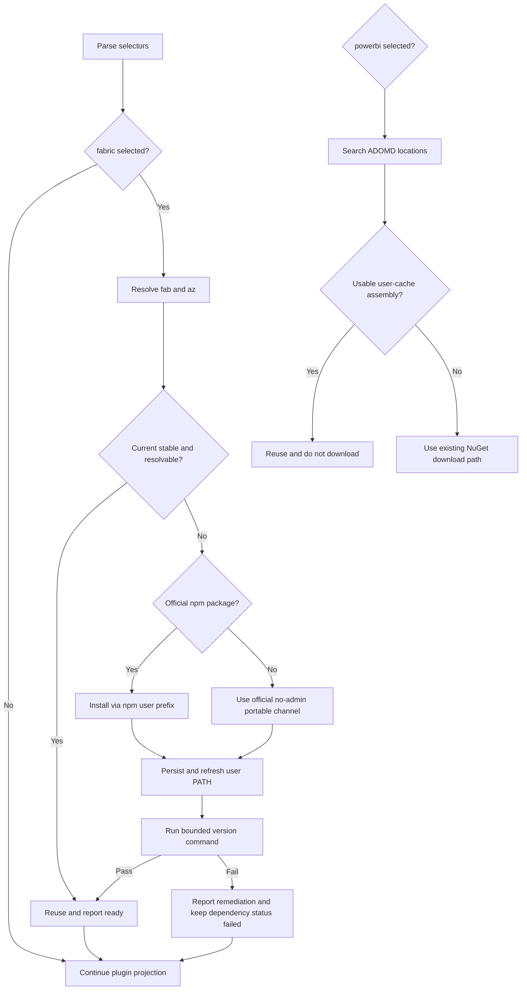

## Context

See `proposal.md` for the motivation. `setup-team-plugins.ps1` already provisions optional dependencies outside plugin-file installation: the Power BI Desktop Bridge uses npm, `uv` uses an official standalone installer and current-process `PATH` refresh, and ADOMD.NET searches known user/package locations before downloading a pinned NuGet package. The new flow must preserve that non-fatal dependency behavior while adding latest-stable `fab` and `az` provisioning and making current user `PATH` updates durable.

The setup script has two externally visible scopes: plugin projection (`Codex`, `Copilot`, or both) and dependency provisioning. `fab`/`az` depend on selecting the `fabric` plugin, not on the selected harness. ADOMD.NET depends on selecting `powerbi` and must remain independent of `-Force`.

## Goals / Non-Goals

**Goals:**
- Provision or reuse current stable `fab` and `az` commands for the `fabric` plugin without elevation.
- Prefer an official npm package for npm-distributed CLIs and use official no-admin alternatives otherwise.
- Keep installs, npm package prefixes, portable archives, and persistent `PATH` updates scoped to the current user.
- Reuse usable installations, including ADOMD.NET in the user NuGet/package cache, before any package download.
- Verify commands in the same process and report per-tool readiness without rolling back plugin projection.

**Non-Goals:**
- Installing Node.js when it is absent; npm availability is a prerequisite for npm routes.
- Inventing or publishing unofficial npm wrappers around Python executables or Azure CLI ZIPs.
- Authenticating `fab` or `az` during setup.
- Upgrading a user-owned tool that is already the latest stable version merely because `-Force` was supplied.
- Replacing machine-wide CLI installations outside the script-owned user profile locations.

## Architecture Diagram

## Decisions

### 1. Separate dependency freshness from plugin force semantics

The setup workflow will treat `-Force` as ownership and replacement authority for selected plugin projections only. CLI and ADOMD dependency functions will always perform capability discovery first and skip installation when a usable current dependency exists.

This matches the current `Desktop Bridge CLI` and ADOMD idempotency expectations and prevents a plugin retry from causing unrelated package churn. The alternative, treating `-Force` as “reinstall every external dependency,” was rejected because it can fail on locked files and is not necessary to refresh plugin content.

### 2. Resolve stable versions from official release metadata

Each CLI tool adapter will resolve the latest stable version from its supported distribution channel, then compare normalized installed and available versions. Prerelease, preview, and development tags are excluded from automatic selection.

For npm-supported tools, the package registry metadata for the verified official package is authoritative. For Azure CLI's Windows ZIP route, Microsoft release metadata or the official latest stable ZIP endpoint is authoritative. Fabric CLI will use an official distribution only; an unverified similarly named npm package is not acceptable. Implementing fixed version constants would make “latest stable” inaccurate without repository changes, so that alternative is rejected.

### 3. Use npm global mode first only when an official package exists

A tool adapter will use `npm install -g --prefix <user-owned-prefix> <official-package>` when Microsoft publishes an official npm package that creates the required command on Windows. `-g` is required so npm creates the normal command shim, while the explicit prefix keeps package files and shims under the current user's profile instead of the machine/global npm location. This preserves the executable lifecycle already used for `@microsoft/powerbi-desktop-bridge-cli` and gives one package lifecycle for npm-distributed tools.

For a CLI without a current supported npm package, the adapter will use the official no-admin route. In particular, Azure CLI can be installed from its official Windows x64 ZIP and invoked from the extracted `bin` directory; setup must not depend on MSI elevation. Fabric CLI will likewise fall back to its official supported package channel rather than an unofficial npm wrapper. This resolves the user's npm preference without making npm an unsupported transport for every CLI.

### 4. Use one user-owned tool root and normalized PATH mutation

Script-owned dependency artifacts will live below a dedicated directory under the current user profile. The npm prefix and portable-archive bin directories are separate children so updates can replace only the affected CLI. A helper will:

1. Read user `PATH` through the user environment target.
2. Split, trim, normalize, and compare entries case-insensitively with trailing separators removed.
3. Append only a missing installer-owned directory.
4. Write the full preserved user `PATH` back to the user environment target.
5. Refresh the current process `PATH` for immediate command resolution.

The helper will not edit machine `PATH`, reorder existing entries, or use substring matching that could confuse one path with another.

### 5. Make each dependency an independent, bounded readiness result

Each external dependency will return a structured result containing name, ready state, installed version, installation path, acquisition channel, and remediation. Setup will verify `fab --version` and `az version` with a timeout and only mark that tool ready after a successful result with a parseable version.

CLI provisioning remains non-fatal to plugin installation, matching `uv` and ADOMD behavior. A failed tool affects that capability's readiness only; the summary includes the failure and the selected target continues unless another target prerequisite is blocked.

### 6. Preserve ADOMD cache discovery and reuse

Before considering an ADOMD download, the existing discovery logic will continue to search the environment override, machine installation, and user NuGet/package cache locations in deterministic order. A file in a user-profile cache is reusable only when it exists, is nonempty, and can be loaded as a managed assembly. A valid result is reported and immediately reused, including under `-Force`.

Invalid candidates do not make ADOMD ready and may fall through to the existing manual/download remediation. This extends the observable contract without changing the pin used by the existing download path.

### 7. Keep test injection at process boundaries

Integration tests will inject package/version discovery, archive download, npm execution, environment variables, command lookup, and version-command results through script blocks or narrow helper parameters. This lets isolated temporary profiles exercise missing, current, outdated, failure, `PATH`, and ADOMD-cache scenarios without downloading external CLIs or changing the developer machine.

## Risks / Trade-offs

- [Official distribution changes] → Resolve channel and package identity in a small tool metadata adapter, and fail closed rather than selecting a similarly named package.
- [Corporate proxies block npm or release archives] → Report the exact channel and manual no-admin remediation; keep plugin setup independently usable.
- [An older system-wide `az` shadows the user install] → Compare resolved command versions and prepend the installer-owned bin directory for the current process while preserving user entries.
- [Persistent `PATH` writes can race with concurrent shell or setup processes] → Read immediately before write, add only normalized missing entries, and avoid rewriting machine `PATH`.
- [Azure CLI ZIP package is previewed by Microsoft] → Treat ZIP as the no-admin supported route documented by Microsoft, verify it explicitly, and preserve a clear fallback message if its contract changes.
- [ADOMD cache detection can accept a file that later fails under the runtime] → Require assembly metadata loading during discovery and retain the existing transport-specific verification.
- [Latest-stable lookup adds network dependency] → Query only for missing/outdated evaluation, reuse a verified current command when release lookup is unnecessary or unavailable, and report the freshness-check limitation.

## Migration Plan

1. Add tool metadata, per-user path, package discovery, bounded command, and structured-result helpers without changing existing setup call order.
2. Add `fab` and `az` orchestration under the `fabric` plugin gate and explicit current-user ADOMD cache assertions under the `powerbi` gate.
3. Extend isolated setup tests with fake acquisition and command runners, including `-Force` and npm-unavailable cases.
4. Update setup documentation and agent guidance with exact verification commands and the official no-admin fallback behavior.
5. Run static and isolated integration checks, then run one controlled real installation on a non-elevated Windows profile to validate user `PATH` persistence.

Rollback consists of restoring plugin backups, removing only script-owned entries from user `PATH`, and removing the dedicated tool root. The setup script must not delete pre-existing CLI installations or machine `PATH` entries, so rollback does not need to reconstruct user-managed tools.
